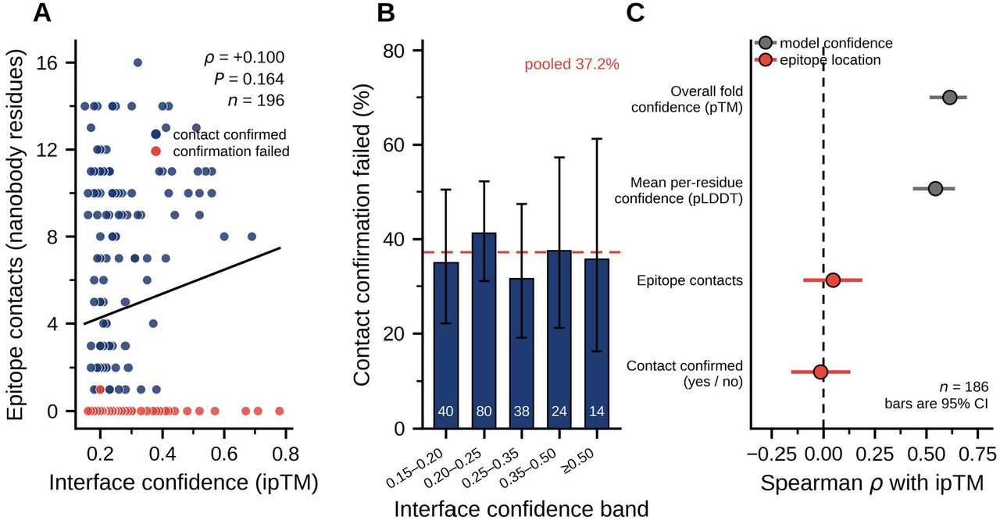
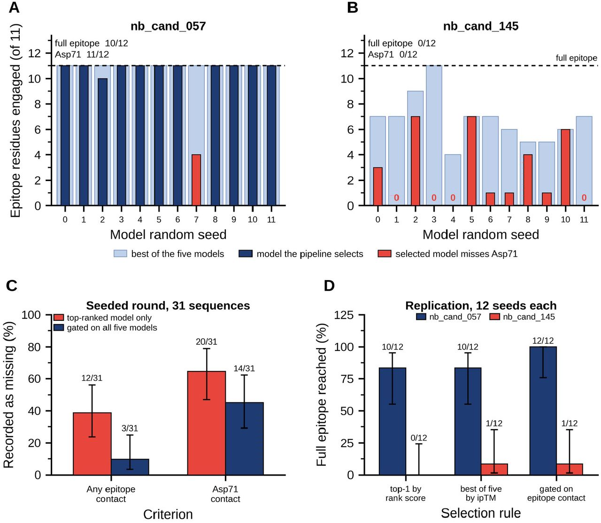
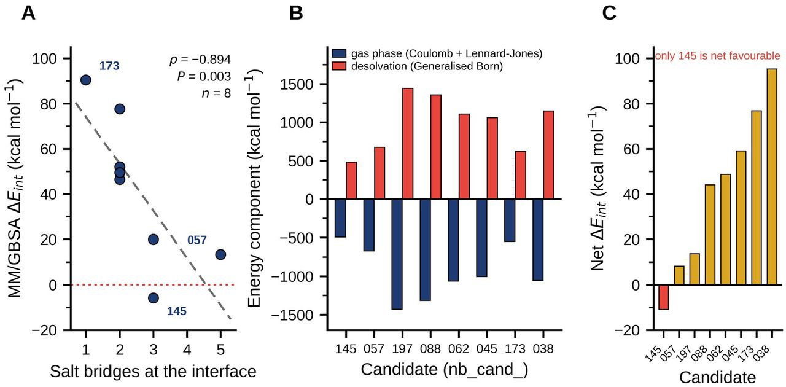

# Benchmarking interface confidence as a selection criterion for computational nanobody design against survivin’s BIR-domain groove

> 日本語精読レポート／対象はbioRxiv **v1**（2026-10-11公開、査読前）。リサーチ日：2026-10-20（JST）。
> HTML版：[図解付き精読ノート](20261020_Benchmarking%20interface%20confidence%20as%20a%20selection%20criterion%20for%20computational%20nanobody%20design%20against%20survivin%20BIR-domain%20groove.html)
> **結論：このライブラリではipTMと目的エピトープへの予測接触に有意な関連を検出できなかった。全モデルの部位確認と複数seedでの再予測が、異なる失敗を見つける。結合・阻害の実験実証はない。**

## まず何の論文か

本論文は、計算設計したナノボディを実験へ進める際に、界面信頼度だけで候補を選んでよいかを検証する研究である。標的はsurvivinのBIRドメインにあるSmac/DIABLO認識溝で、既知結晶構造から目的エピトープを11残基に定義した。ヒト化VHH骨格を固定し、CDR3だけを重み付きランダムサンプリングで200種類作製した。これは新しい拡散モデルや抗体言語モデルの提案ではない。196候補をAlphaFold-Multimerで共折りたたみし、モデル中でCDR3が狙った部位へ触れているかを直接確認した。123候補はこの接触基準を満たしたが、73候補は満たさなかった。ipTMとエピトープ接触数とのSpearman相関はρ=+0.100で、統計的に有意ではなかった。一方、ipTMは同じ予測から出るpTMや平均pLDDTとは関連していた。さらに、単回の構造・エネルギー評価で上位だった2候補を12 seedで再予測すると、nb_cand_057は完全エピトープ接触を10/12回再現し、nb_cand_145は0/12回だった。31配列について全5モデルを調べると、上位1モデルの採用が目的部位に触れる別のモデルを捨てている例が多かった。したがって実務上の価値は、候補配列そのものに加えて「目的部位の確認」と「予測の再現性」を選別工程へ組み込む評価設計にある。ただし、ここでの成功とは予測座標上の接触であり、発現、実結合、親和性、細胞内阻害は測定していない。[原著 Abstract、§§3.1–3.3、Discussion](https://www.biorxiv.org/content/10.64898/2026.10.04.753929v1.full)

## 書誌情報

- URL/DOI：[bioRxiv v1本文](https://www.biorxiv.org/content/10.64898/2026.10.04.753929v1.full)／[10.64898/2026.10.04.753929](https://doi.org/10.64898/2026.10.04.753929)
- 公開日/更新日：指定v1は**2026-10-11**。DOI中の2026.10.04を公開日と混同しない。[Info/History](https://www.biorxiv.org/content/10.64898/2026.10.04.753929v1.article-info)
- 著者：Charlotte Gately、Xinyao Guan、Xianting Ding。
- 所属：Shanghai Jiao Tong UniversityのXinhua Hospital／医学・医工学関連部門（3名）、Case Western Reserve University College of Arts and Sciences（Gately）、Bengbu Medical University第一附属病院検査部（Ding）。正確な所属表記はInfo/Historyを参照。
- 掲載：bioRxiv、Bioinformatics。査読前プレプリント。
- リサーチ日：2026-10-20（JST）。分類：新着／選別基準のベンチマーク／ナノボディ設計。
- 論文ライセンス：CC BY 4.0。コードとデータのライセンスは後述。

## 背景と問題設定

survivin（BIRC5）は細胞分裂とアポトーシス制御に関係する細胞内タンパク質である。この研究が扱うのは、その全表面ではなくBIRドメインのペプチド認識溝である。Smac/DIABLO由来AVPIとH3T3phペプチドが結合する既知構造があり、Asp71には既報のD71R変異による機能的根拠がある。著者はこの残基を、単なる接触数の一部より強い確認点として扱う。ただし、候補がAsp71へ近づくこと自体が阻害を証明するわけではない。[原著 Introduction、§2.1](https://www.biorxiv.org/content/10.64898/2026.10.04.753929v1.full#sec-1)

抗体設計では、複合体予測後にipTMなどで足切りし、残った候補だけを詳細に調べることが多い。しかし、ipTMは指定エピトープの番号を評価目的として与えられた指標ではない。別の表面で整合的な界面を作ったモデルも高く評価しうる。フィルターを通過した候補だけを見ると、「低スコアでも目的部位に接触した候補」を捨てる問題が見えない。本研究はライブラリ全体で接触を確認し、その取りこぼしを可視化する。[原著 Introduction、Discussion](https://www.biorxiv.org/content/10.64898/2026.10.04.753929v1.full)

## この論文のコアアイデア

**配列を選ぶ問題、同じ配列の5モデルから構造を選ぶ問題、選んだ配列が再予測でも同じ部位へ来るかという問題を分ける。**

1. 設計前に機能に関連する標的部位を残基番号で固定する。
2. 共折りたたみ後、信頼度と別に、目的部位への重原子距離を測る。
3. CDR3由来の接触と、共通骨格・CDR1/CDR2由来の接触を区別する。
4. 全5モデルを確認して選別による取りこぼしを調べ、上位候補を12 seedで再予測する。

接触ゲートは一回の実行内での構造選択を補い、再予測は候補の安定した挙動を調べる。どちらも実験結合の代用にはならない。[原著 §§2.5–2.9、3.3](https://www.biorxiv.org/content/10.64898/2026.10.04.753929v1.full)

## 手法の詳細

### 標的とライブラリ

PDB [3UIH](https://www.rcsb.org/structure/3UIH)と[3UIG](https://www.rcsb.org/structure/3UIG)で、ペプチド重原子から4.5 Å以内のsurvivin残基をそれぞれ抽出し、共通集合を取る。得られた11残基は **Glu51、Met54、Lys62、Glu63、Leu64、Glu65、Gly66、Trp67、Asp71、Glu76、His80**。5残基が酸性で、Trp67などの疎水・芳香族面もある。番号は全長survivinに基づき、切り出した構築体内の番号と取り違えない。

VHHはPDB [3EAK](https://www.rcsb.org/structure/3EAK)のh-NbBcII10FGLA骨格を使い、[3DWT](https://www.rcsb.org/structure/3DWT)との照合でヒト化置換13個を確認した。元のCDR3は18残基で、保存CysとFR4のWGQGTモチーフから交換範囲を特定する。CDR1、CDR2、その他の骨格は全候補共通である。

CDR3は酸性溝に対してArg/Lysを優先し、極性、芳香族、疎水、柔軟性を担う残基を重み付きでサンプリングする。長さ12–20残基、正味電荷+1〜+5、Proは2個以下、同一残基は4個以下、疎水残基の連続は3個以下とし、余分なジスルフィドを避けてCysを除く。乱数seedは固定。**本研究で学習するニューラルネットワークや損失関数はなく、既存予測器を利用する。**[原著 §§2.1–2.3](https://www.biorxiv.org/content/10.64898/2026.10.04.753929v1.full)

### 複合体予測と接触の定義

| 項目 | 条件・解釈 |
|---|---|
| 入力 | 候補VHH配列＋1F3H chain A由来survivin 21–110（90残基） |
| 予測器 | ColabFold 1.6.2、AlphaFold-Multimer v3、unpaired MSA、3 recycles、各5モデル |
| 当初の採用規則 | 0.8×ipTM＋0.2×pTMが最大のモデル |
| 接触数 | 11エピトープ残基のいずれかから重原子距離4.5 Å以内にある**ナノボディ側残基数** |
| 接触確認の合格 | 再設計したCDR3が目的エピトープに接触すること |
| エピトープ被覆 | 接触された**標的側11残基のうち何残基か**。接触数とは別の量 |
| 詳細解析 | 接触数14以上で10候補をshortlist化。Asp71接触、各CDRと骨格の寄与を解析 |
| 反復 | 2候補×12 seed×5モデル＝120モデル。同一MSAを共有 |
| 計算資源 | 共折りたたみはNVIDIA T4、エネルギー評価はCPU。無料計算環境を使用 |

unpairedは両鎖のMSAを残しつつペアリングしない設定であり、MSAを除去するsingle-sequence modeとは異なる。後者はsurvivin側も情報を失い、試行でipTM 0.07–0.13となったため採用しなかった。[原著 §§2.4–2.6、2.9](https://www.biorxiv.org/content/10.64898/2026.10.04.753929v1.full)

補足Methodsでは、塩橋は荷電基N–O間4.0 Å以内、水素結合候補はN/O重原子間3.5 Å以内、疎水接触は非極性残基C–C間4.5 Å以内、芳香族接触は環重心間6.0 Å以内とする。水素も角度条件もないため、表中の水素結合数は距離ベースの候補数である。[補足Methods S1](https://www.biorxiv.org/content/biorxiv/early/2026/10/11/2026.10.04.753929/DC1/embed/media-1.pdf)

### MM/GBSAと統計

OpenMM 8.5、PDBFixer、pH 7.0、amber14＋GBn2を使う。重原子を5 kcal mol⁻¹ Å⁻²で拘束し500 step最小化した後、同じ座標上で **ΔE_int = E_complex − E_receptor − E_nanobody** を計算する。孤立鎖の再最小化はせず、結合項は相殺される。エントロピーも構造集団のサンプリングもなく、Kdや真の結合自由エネルギーへ変換しない。500→1000 stepの差は単一候補の収束試験で約2 kcal/mol未満だった。受容体単独エネルギーの異常から129と169を事後的に除外し、8候補を解析した。[原著 §2.7、補足Methods S2–S3](https://www.biorxiv.org/content/10.64898/2026.10.04.753929v1.full)

主解析はSpearman相関。Fisher zによる95% CIを20,000回bootstrapでも確認し、割合にはWilson区間、群比較にはMann–WhitneyとFisher正確検定を用いる。回帰には電荷、長さ、Pro数、芳香族数、ipTM、batchを検討した。多重比較補正は行っていないため、小標本で一つだけ有意になった結果を確証と扱わない。[原著 §2.10](https://www.biorxiv.org/content/10.64898/2026.10.04.753929v1.full)

## データセットと評価設計

| 集合 | 規模 | 何を評価するか | 主な制約 |
|---|---:|---|---|
| 主ライブラリ | 設計200、評価196 | ipTMと目的部位接触の関係 | 4候補は計算中断で欠落。1標的・1骨格 |
| 信頼度3指標の比較 | 186候補 | ipTM、pTM、平均pLDDTの関連 | 全信頼度出力の記録がある部分集合 |
| 保存界面の領域別解析 | 109構造中104件 | CDR3／骨格寄与と被覆 | 接触合格例だけを保存。5変異体はCDR3境界なし |
| shortlist | 10候補、MM/GBSA有効8 | 被覆、Asp71、塩橋、エネルギー | 接触数で選んだ後の狭い集合 |
| 再予測 | 057と145、各12 seed×5 | 実行内の選別と実行間の再現性 | 同一MSA。12回は12独立配列ではない |
| seeded round | 親145＋3群×10＝31配列、155モデル | 酸性／塩基性／中性変異、全モデル確認 | 親の姿勢が再現しない。各群10件 |
| 追加変異・交差 | 20変異体 | 保守的変異とcrossover | 補足S5。最終shortlistには入らない |
| 単量体予測 | 10候補＋親骨格＝11 | 標的なしでの領域別信頼度 | 複合体とは別ネットワーク・MSA |

train/validation/test分割は**該当なし**。新モデルの教師あり学習ではなく、設計集合上の指標の挙動を観察した研究である。外部の未知標的へのテストや抗体系列クラスタ分割はない。AlphaFoldの事前学習データと既知構造との重複監査も本研究では確認できないため、既知骨格を使うこの評価を「未知抗体構造の予測精度評価」とは読まない。[原著 Methods、Data availability](https://www.biorxiv.org/content/10.64898/2026.10.04.753929v1.full)

良い点は、足切り前の196候補を評価して選択の偏りを減らしたことと、接触基準を構造由来で明示したことである。一方、正解ラベルも予測座標から算出するので、測っているのは「モデルが設計意図を表現したか」である。実験的なbinder/non-binder分類精度、ROC-AUC、Kd誤差は評価していない。

## 主要結果

### 1. 信頼度は目的部位への接触を選別できたか

196候補中、CDR3接触合格は123/196＝62.8%（95% CI 55.8–69.2）、不合格は73/196＝37.2%。不合格の内訳は、全ナノボディで接触ゼロの72候補と、CDR3以外だけが1接触したnb_cand_163である。**接触数>0を合格ラベルにすると、論文と1件ずれる。**

| 比較 | 結果 | 読み方 |
|---|---|---|
| ipTM vs 接触数、n=196 | Spearman ρ=+0.100、95% CI −0.04〜+0.24、P=0.164 | 関連を検出できない。厳密な無相関の証明ではない |
| ipTM 0.15–0.20群の不合格率 | 14/40＝35.0% | 低信頼度帯 |
| ipTM ≥0.50群の不合格率 | 5/14＝35.7% | 高い帯でも低下しない。nが小さくCIは広い |
| 最高vs最低四分位の不合格odds比 | 0.97、95% CI 0.41–2.26、P=1.000 | 四分位比較でも差を検出できない |
| ipTM vs pTM、n=186 | ρ=+0.614 | 信頼度同士は関連 |
| ipTM vs 平均pLDDT、n=186 | ρ=+0.544 | 同上 |

ipTMの最高3候補130、147、146はそれぞれ0.78、0.71、0.67だがエピトープ接触ゼロだった。逆に、接触数14以上の10候補は全てipTM 0.15–0.42であり、0.50足切りでは全て落ちる。ただし中央値0.23で、0.50以上は14/196しかない。この低信頼度中心の限定的な分布を、高信頼度候補が豊富な別ライブラリへ外挿しない。[原著 §3.2、Figure 2](https://www.biorxiv.org/content/10.64898/2026.10.04.753929v1.full#F2)

### 2. 12 seed再予測は、単回上位の2候補を分けた

| 採用した最高rank_scoreモデルの評価 | nb_cand_057 | nb_cand_145 |
|---|---:|---:|
| 何らかのエピトープ接触 | 12/12 | 8/12 |
| 11残基全ての被覆 | 10/12（83.3%） | 0/12 |
| Asp71接触 | 11/12（91.7%） | 0/12 |
| 被覆残基数の中央値 | 11 | 1 |
| 塩橋数の中央値 | 5 | 0 |
| 5モデルのどれかで全11残基を被覆 | 12/12 | 1/12 |

057の完全被覆率の95% CIは55.2–95.3%、145の0/12でも上限は24.2%である。Asp71接触の比較はFisher P=9.6×10⁻⁶。145は元の単回構造で完全被覆し、MM/GBSAも最良だったが、その姿勢を再予測で再現できなかった。一方で、5モデルのどれかが少しでもエピトープへ接触するという緩い条件なら145も12/12となる。**部分接触の救済と、機能的に重要な部位の安定した被覆は別である。**[原著 §3.3、Figure 3、Table 1](https://www.biorxiv.org/content/10.64898/2026.10.04.753929v1.full#F3)

### 3. 上位1構造の選択が捨てていたもの

31配列のseeded roundでは、上位rankモデルだけならエピトープ接触ゼロは12/31（38.7%）。5モデル全てに接触がないのは3/31（9.7%）だった。見かけの失敗12件中9件には別の接触姿勢が既に存在した。この比較は「5回の最良」は有利という多重試行の効果を含むため、それだけで順位付けの無効性を証明しない。

より直接的には、上位31モデルと棄却された124モデルで、平均被覆は4.2対3.6残基（Mann–Whitney P=0.610）、接触ゼロ率は38.7%対37.9%だった。著者はランダム選択に対する優位を検出できないと解釈する。ただし、同じ配列のモデル同士は依存しており、非有意差は同等性の証明ではない。再予測24実行ではipTM単独への順位変更も23/24回で同じ構造を選んだ。元のrank_score自体が80% ipTMなので、この一致は予想される。[原著 §3.3、Table 1、補足S6](https://www.biorxiv.org/content/10.64898/2026.10.04.753929v1.full#T1)

### 4. 接触の量だけでは設計CDR3の寄与を評価できない

shortlistの被覆は11残基が6候補、10残基が2候補、9残基が2候補。129と173はAsp71を外した。CDR3の界面寄与は41.2–85.7%で、最大接触数16の197は最小寄与41.2%だった。197の界面34残基ペア中20は固定したCDR1/CDR2に由来し、接触数首位をCDR3設計だけの成果とみなせない。対照的に、10候補で数えた塩橋28本は全てCDR3由来だった。[原著 §3.4、Figure 4、補足Table S2](https://www.biorxiv.org/content/10.64898/2026.10.04.753929v1.full#F4)

保存構造104件では、CDR3が全界面へ占める比率の中央値は50.9%。Asp71接触54件では61.4%、非接触50件では40.0%だった。一方、ipTMと骨格接触数の相関は**負**（ρ=−0.321）であり、「固定骨格がipTMを吊り上げた」とは結論していない。合格例のみの解析で、同じ座標から作った量同士の関係である。[原著 §3.2、補足S7/Table S4](https://www.biorxiv.org/content/10.64898/2026.10.04.753929v1.full)

### 5. エネルギーの順位も単回構造に依存する

| 候補 | 初回ΔE_int（kcal/mol、低い方が有利） | Asp71 | 塩橋数 |
|---|---:|---|---:|
| 145 | −5.8 | 接触 | 3 |
| 057 | +13.4 | 接触 | 5 |
| 197 | +20.0 | 接触 | 3 |
| 173 | +90.5 | 非接触 | 1 |

Table 2から比較に必要な4候補だけを抜粋した。QC通過8候補全体で塩橋数とエネルギーはρ=−0.894（P=0.003）、再計算では−0.830。leave-one-outでも方向は保たれたが、8特性を8候補で検討して補正していない探索結果である。総電荷は気相相互作用とρ=−0.933、脱溶媒和罰則と+0.933だが、差し引き総エネルギーとは+0.258（P=0.538）だった。電荷を増やすことと、適切な位置に塩橋を作ることは同じではない。[原著 §3.5、Table 2、補足Table S1](https://www.biorxiv.org/content/10.64898/2026.10.04.753929v1.full#T2)

気相項−492.8〜−1428.2 kcal/molと脱溶媒和項+481.9〜+1442.0 kcal/molが相殺し、総量は小さな差になる。再計算で個別値は平均7.8、最大17.6 kcal/mol動いた。正の値を「実験で結合しない」と読まず、負の値もbinder認定に使わない。**Figure 5Cは分解再計算の値（例057は+8.27）で、Table 2の初回値（+13.41）とは別計算**である。両者を同じデータ列として混ぜない。[原著 §3.5、Figure 5、著者配布CSV](https://zenodo.org/records/23131327)

### 6. 電荷の探索と単量体の折りたたみ

主集合では電荷と接触数はρ=+0.319、回帰では電荷1単位あたり接触合格odds比1.48（95% CI 1.14–1.91、P=0.003）。ipTMは0.1増あたりodds比1.00（P≈0.99）だった。ただしモデル全体のpseudo-R²は0.063と小さい。

145を親にした3群各10変異体では、塩基性群のCDR3接触は8/10、中性対照は4/10（P=0.170）。Asp71接触は8/10対2/10（P=0.023）だが、多重比較未補正で確証とは扱わない。酸性群の接触は4/10で改善しなかった。30変異体の電荷–接触ρ=+0.535も、群を定義した電荷を再表現した関係であり、独立検証ではない。親145の姿勢自体が再現しないため、特定塩橋の最適化が成功したとはいえない。[原著 §§3.1、3.6](https://www.biorxiv.org/content/10.64898/2026.10.04.753929v1.full)

標的なし単量体予測では骨格pLDDT 91.7–94.8（親94.6）、CDR3は65.1–82.2（親73.3）。予測上、骨格を大きく崩した兆候はないが、発現・溶解性・熱安定性の証明ではない。複合体CDR3の45.9–62.1とは予測条件が違い、数値差をそのまま結合による不安定化と読めない。[原著 §3.7、Figure 6、補足S4](https://www.biorxiv.org/content/10.64898/2026.10.04.753929v1.full#F6)

## 重要なFigure/Table

全6 Figureと2 Tableの本文・キャプション、原著PDFおよび補足4ページを確認し、主張を追うためにFigure 2、3、5を掲載した。原図はGately、Guan、Ding（2026）作成、[原著v1](https://doi.org/10.64898/2026.10.04.753929)、[CC BY 4.0](https://creativecommons.org/licenses/by/4.0/)。以下の画像はbioRxiv配布JPEGを改変せず保存し、表示サイズのみ調整した。

### Figure 2：信頼度と目的部位は別の評価軸

Aは196候補のipTM（横）対ナノボディ側接触残基数（縦）。回帰線の傾きだけで判断せず、ゼロ接触が高ipTMまで分布する点を見る。Bは信頼度帯別の不合格率で、棒の誤差は95% Wilson区間、棒内数字はn。Cは完全な信頼度記録のある186候補に限定するため、Aのρ=0.100とCの接触数相関ρ≈0.047は異なる集合の値である。[原図](https://www.biorxiv.org/content/biorxiv/early/2026/10/11/2026.10.04.753929/F2.large.jpg)

### Figure 3／Table 1：選別の改善と候補の再現性を区別する

A/Bはseedごとの被覆。濃色は採用構造、淡色は5モデル中の最大被覆、赤は採用構造がAsp71を外した実行である。Cでは任意の接触とAsp71接触を別々に読む。Dで057は接触ゲートにより完全被覆10/12→12/12になるが、145は1/12止まり。Table 1の31配列列は「接触ゼロの件数」、反復列は「完全被覆の回数」であり、列を跨いで成功率のように比較しない。[原図](https://www.biorxiv.org/content/biorxiv/early/2026/10/11/2026.10.04.753929/F3.large.jpg)

### Figure 5／Table 2：相殺する大きなエネルギー項

Aは塩橋数（横）と初回エネルギー（縦、kcal/mol、低いほど有利）。B/Cは分解再計算で、Bの大きな反対符号の項を足したCは別スケールである。Aの初回値とCの再計算値の差は計算の感度を示す。最良初回エネルギーだった145の姿勢は再現しないため、エネルギー順位が配列の結合能を保証する図ではない。[原図](https://www.biorxiv.org/content/biorxiv/early/2026/10/11/2026.10.04.753929/F5.large.jpg)

## Code / License / Weights

- コード公開：**あり**。著者によるZenodo配布。[公式データ・構造・コード](https://zenodo.org/records/23131327)／[ZIP](https://zenodo.org/api/records/23131327/files/SVN057_survivin_nanobody_dataset.zip/content)
- GitHub URL：**見つからず**。本文、Zenodoの関連識別子・README、論文名でのGitHub検索で公式リポジトリを確認できなかった。GitHubがなくてもコード非公開という意味ではない。
- 実装種別：著者実装。GitHub確認：該当なし。ライセンス：コードMIT、データ・構造・図CC BY 4.0。
- ライセンス確認元：ZIP内`LICENSE-CODE.txt`、`LICENSE-DATA.txt`とREADMEを直接確認。Zenodo metadataはデータのCC BY 4.0を表示する。
- Hugging Face URL／種別：見つからず／該当なし。論文・配布物に記載なく、著者名＋survivin＋Hugging Face検索でも専用公開先を確認できなかった。
- モデル重み・チェックポイント：本研究独自学習モデルは**該当なし**。利用するAlphaFold/ColabFoldの既存重みはこの研究の新規成果ではない。ZIPに新規学習重みの配布は確認できない。
- データセット公開：あり。196候補のTSV、各batch CSV、12 seed反復120モデルの集計、31配列155モデルの集計、単量体信頼度、エネルギー分解、109候補のPDB等を配布。
- 実装入口：`scripts/generation/`で配列・入力生成、`scripts/analysis/`で接触・MM/GBSA、`scripts/figures/loaddata.py`と`makefigs.py`で読み込み・描図。
- 利用条件：配布コードのMITと、利用する予測器・配列DB・計算サービスの条件は別途扱う。

### 今回の独立確認と再現性メモ

Zenodo ZIPのMD5 **b066b08bd5fa03285ad8a293508da22e** が公式APIの値に一致した。第三者コードを実行せず、配布TSVをPython標準ライブラリで読み、次を独立再集計した。[検証結果JSON](assets/20261020_survivin_interface_confidence/verified_summary.json)

- 主集合196、CDR3接触合格123、全体接触ゼロ72。順位同値を平均順位で扱うSpearman ρ=**0.0999034577**。
- 057：60モデル、最高rank_scoreで完全被覆10/12、Asp71 11/12、どれか1モデルで完全被覆12/12。
- 145：60モデル、同条件で完全被覆0/12、Asp71 0/12、どれか1モデルで完全被覆1/12。
- seeded round：31配列155モデル、最高rankで接触ゼロ12件、全モデル接触ゼロ3件。

これらは論文の主要集計と一致した。ただし、全統計検定、共折りたたみ、MD、MM/GBSAの再実行までは行っていない。

**配布版と指定v1の差を記録する。** Zenodo READMEは旧題、DOI未記入、Figure1–7の7図構成を示すが、指定v1はFigure1–6の6図構成である。論文Data availabilityは統計検証スクリプトを述べるものの、今回取得したZIPのファイル一覧に独立したverification名のスクリプトは見つからなかった。統計確認機能が別ファイルに含まれる可能性は未確認。したがって、配布READMEの図番号をそのまま本文v1へ対応させず、内容で照合する。失敗73候補の座標は保存されず、元の196件すべてについて座標から接触判定を再計算できない。109構造は主ライブラリ合格123件中104件と追加変異体5件であり、失敗例も含めた全構造公開ではない。[原著Data availability／Zenodo README](https://zenodo.org/records/23131327)

## 抗体研究・創薬への意味

本研究から転用しやすいのは、抗体候補のスコア順位をそのまま成功順位と見なさず、設計目的を満たしているかを別の列で管理する運用である。少なくとも、目的残基への接触、Asp71のような機能関連部位、設計CDRの寄与、モデル間被覆の分布を併記すると、信頼度だけでは見えない失敗が分かる。目的部位が既知なら接触確認は既存座標から計算できる。

本レポートの実務的提案としては、候補を絞る前に5モデルを保存し、部位確認の結果と信頼度を並べ、候補間の小さな接触数差で順位を確定せず、反復予測後に実験へ進める。057を試す場合も、まず精製survivinへの結合測定、Smacペプチド競合、予測CDR3塩橋の変異実験が必要である。これは著者も次段階として提案する。細胞内標的なので、結合が確認できても細胞内送達や細胞内機能阻害は別の開発課題として残る。[原著Discussion](https://www.biorxiv.org/content/10.64898/2026.10.04.753929v1.full)

## 限界と注意点

### 著者が明記する限界

- 発現・精製・親和性・競合・細胞評価を一切実施していない。057はin silico候補である。
- 1タンパク質の1エピトープ、1骨格、CDR3のみの設計。相関係数や閾値の汎用性は示さない。
- ipTMが低いライブラリに偏る。0.5以上の14例のみで高信頼度帯全体を評価できない。
- shortlistの構造・エネルギーは単回予測に依存。再現性確認は2/10候補だけで1候補は失敗した。
- MSAを共有する12 seed反復は、MSA検索サーバーやalignment変動を含めない。
- survivinは21–110の単量体構築体で、C末端二量体化ヘリックスと二量体状態を表現しない。
- MM/GBSAは単一最小化構造・暗黙溶媒・エントロピーなし、8例、事後QC、多重比較未補正。
- 保存構造は接触合格例へ偏るため、領域別解析は不合格候補の説明へ使えない。

### 本レポートの批判的評価

- **非有意は同等性や普遍的無効性の証明ではない。** ρのCIは弱い正相関も許す。ipTMが無意味という結論へ広げない。057の同一配列60モデル内ではρ=+0.482であり、候補間評価とモデル間評価を区別する。
- 接触ゲートは設計目的との一致を直接評価するが、予測誤りでも合格できる。全5モデルから最良を選ぶほど偶然の接触を拾う余地が増えるため、実験成功率の改善を示したとはいえない。
- 上位対棄却モデル比較には配列内依存がある。配列単位のペア比較や階層的bootstrapによる追試が有用だと考える。
- Asp71の既報変異効果は重要な外部根拠だが、全阻害候補にAsp71直接接触が必須と本研究が実証したわけではない。
- 単量体pLDDTの良好さは、溶解性、凝集性、発現量、熱安定性や免疫原性の代替指標ではない。
- 196件の集計は検証可能でも、全件の元座標がない点と公開物の版差により、完全な再実行・監査は限定される。

## この論文を読む上での前提知識

- **VHH／ナノボディとCDR3**：重鎖由来の単一可変ドメイン。3つのCDRのうち本研究はCDR3のみ変更するため、他領域の接触を設計効果と混同しない。
- **ipTM、pTM、pLDDT**：それぞれ界面、全体配置、局所構造の予測信頼度に関連する値。結合親和性や指定部位への選択性を直接測定した値ではない。
- **MSAとunpaired**：進化的に関連する配列の整列情報。新規binderと標的に共進化ペアがないため、本研究では各鎖の情報を残して非ペア化する。
- **接触数と被覆**：前者はナノボディ側、後者は標的側の残基を数える。どちらも重原子距離の閾値に依存する。
- **MM/GBSA**：分子力学と暗黙溶媒による近似的エネルギー評価。本研究の値は実験Kdへ直結しない。
- **seed反復と信頼区間**：同じ配列でも予測モデルが変わりうる。比率のCIは12回程度では広く、同じMSAを使う反復は全変動要因を網羅しない。

## 今回この1報を選んだ理由

ユーザー指定論文である。AI×抗体設計の実務で使う選別指標を、完全なライブラリ評価と反復で見直せるため、精読価値が高い。新規モデルの性能競争よりも、実験へ進める判断の根拠を学ぶ新着ベンチマークとして位置付けた。他候補との新規な優劣選定は行っていない。

## 読む優先度

**High（評価設計の学習として）**。構造予測を使った抗体設計で、信頼度、部位一致、再現性を区別するうえで有用。治療抗体としての成功例や高親和性binderの実証を探す用途では、未検証であることを前提に読む。

## 自分用メモ

- 057を出発点とした変異探索を、全モデル保存・MSA変動込みで追試したい。
- 4.5 Å閾値の感度、部分被覆とAsp71基準、CDR別寄与を分けた候補比較を行いたい。
- 関連原著：既知認識構造を示す[Du et al., 2012](https://doi.org/10.1016/j.str.2011.12.001)、機能変異の[Song et al., 2003](https://doi.org/10.1074/jbc.M300957200)、ヒト化骨格の[Vincke et al., 2009](https://doi.org/10.1074/jbc.M806889200)。ここでは本論文の引用として参照し、個々の再精読は未実施。
- 関連ベンチマーク：[Overath et al.](https://doi.org/10.1101/2025.08.14.670059)は実験binder成功を扱う比較対象。目的部位接触を扱う本研究とは評価ラベルが違う。
- 実装入口はZenodoの`data/library_sweep_196.tsv`。`contact_confirmed`をラベルにし、接触数>0で置き換えない。
- 既存[[20261020_SpatialPPI Three-dimensional space protein-protein interaction prediction with AlphaFold Multimer]]と接続し、PPIの有無・目的部位・親和性を別タスクとして整理する。

## 関連キーワード

[[ナノボディ]]、[[VHH]]、[[CDR3]]、[[Survivin]]、[[BIRC5]]、[[エピトープ]]、[[AlphaFold-Multimer]]、[[ColabFold]]、[[ipTM]]、[[MM-GBSA]]、[[塩橋]]、[[再現性]]、[[候補選別]]。

## 検索ログ

- 対象固定：ユーザー提示DOIのbioRxiv v1。Web取得では本文/PDFへアクセスできず、通常ブラウザで本文を確認した後、HTTP取得で原著PDFと補足PDFも取得できた。アクセス制限の回避は実施していない。
- 一次資料：[本文](https://www.biorxiv.org/content/10.64898/2026.10.04.753929v1.full)、[Info/History](https://www.biorxiv.org/content/10.64898/2026.10.04.753929v1.article-info)、[原著PDF](https://www.biorxiv.org/content/10.64898/2026.10.04.753929v1.full.pdf)、[補足ページ](https://www.biorxiv.org/content/10.64898/2026.10.04.753929v1.supplementary-material)、[補足PDF](https://www.biorxiv.org/content/biorxiv/early/2026/10/11/2026.10.04.753929/DC1/embed/media-1.pdf)、[Zenodo](https://zenodo.org/records/23131327)、[公式API](https://zenodo.org/api/records/23131327)。
- 書誌：2026-10-11公開、CC BY 4.0をInfo/Historyで確認。全6 Figureと2 Tableの記述を確認し、Figure 2/3/5の配布原図を画像として確認・保存、Table 1/2と補足Table S1–S4をPDFテキストから照合した。補足3ページ目はレンダリングでも確認。
- コード検索クエリ：`"10.64898/2026.10.04.753929"`、`"Benchmarking interface confidence" github`、`"Gately" "survivin" "huggingface"`。検索結果は発見用で、内容の根拠は一次資料に限定。
- コード／重み確認先：本文Data availability、Zenodo API関連リンク、ZIP README、LICENSE2種、全ファイル一覧。GitHub、Hugging Face専用公開先は見つからず。新規モデル重みは該当なし。
- データ確認：ZIPの公式MD5照合、主集合と反復の主要件数・順位相関を独自再集計。第三者配布スクリプトの実行、AlphaFold/ColabFoldの再推論、MM/GBSA再計算は行っていない。
- 版差：Zenodoは7図、指定v1は6図。レポートの図番号はv1基準。Figure 5の初回と分解再計算の差をCSVで確認。
- 他候補の選定や新着／基盤の比率調整は今回対象外。新着の指定論文として記録。
