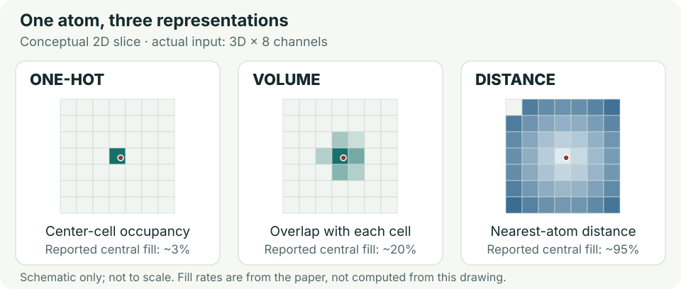

# SpatialPPI: Three-dimensional space protein-protein interaction prediction with AlphaFold Multimer

> HTML版: [ビジュアル精読ノート](20261020_SpatialPPI%20Three-dimensional%20space%20protein-protein%20interaction%20prediction%20with%20AlphaFold%20Multimer.html)
> 「SpacialPPI」として指定された論文の正式表記は **SpatialPPI**。本ノートは2024年の原著を対象とし、2025年のSpatialPPIv2とは区別する。

## まず何の論文か

この論文は、AlphaFold Multimerが出力した複合体構造を使い、2つのタンパク質が相互作用するかを分類する研究である。構造予測がもっともらしい複合体を出しても、その2分子が実際に結合する証拠にはならないという問題を扱う。著者のWenxing Huと大上雅史は、予測構造の界面を3次元の格子へ変換し、画像認識で使われる3D-CNNに読ませるSpatialPPIを提案した。各格子には、2本の鎖それぞれの炭素・窒素・酸素・硫黄の情報を分けて格納する。原子の存在だけを記録するone-hot、占有体積を記録するvolume、周囲の原子までの距離を記録するdistanceの3表現を比較した。実験由来の相互作用・非相互作用データを各600ペア集め、ヒト375タンパク質からなる計1,200ペアで評価した。最良構成はdistance encodingとDenseNet3Dの組合せで、5分割交差検証の正解率は81.8%、ROC-AUCは0.892だった。DeepTrioやSpeedPPIより高いAUCを報告する一方、precisionはPEPPIが上回った。追加データの陰性は配列シャッフルで作られており、実験由来の陰性と同じ難しさとは扱えない。さらに、公開コードの分割処理だけでは、未知タンパク質への厳密な汎化が保証されるとはいえない。抗体研究には「予測構造を結合判定へ使う」発想が参考になるが、抗体専用評価もKd予測も行っていない点が重要である。[本文 §§2–3](https://pmc.ncbi.nlm.nih.gov/articles/PMC10966450/)

## 書誌情報

- URL/DOI: [10.1016/j.csbj.2024.03.009](https://doi.org/10.1016/j.csbj.2024.03.009)
- 本文・書誌: [PMC10966450](https://pmc.ncbi.nlm.nih.gov/articles/PMC10966450/) / [PubMed 38545599](https://pubmed.ncbi.nlm.nih.gov/38545599/)
- 公開日/更新日: 2024-03-15。受理2024-03-10。PMCのcollection date「2024 Dec.」は初回公開日と区別する。
- 著者・所属: Wenxing Hu、Masahito Ohue（大上雅史、責任著者）。発表時の所属は東京工業大学 情報理工学院 情報工学系。
- 掲載誌/プレプリントサーバー: Computational and Structural Biotechnology Journal, 23, 1214–1225（2024）。査読済み原著。
- リサーチ日: 2026-10-20（JST）
- 分類: 基盤 / モデル起点 / タンパク質間相互作用予測

## 背景と問題設定

PPI予測には、配列だけから判定する方法と、立体構造から界面を評価する方法がある。前者は入力を集めやすいが空間配置を直接扱いにくく、後者は実験構造の不足が制約になる。AlphaFold Multimerはこの不足を補える一方、非結合ペアにも構造を出力するため、構造の生成と結合の判定を分ける必要がある。

界面の平均pLDDTやドッキングスコアだけで判定する方法もあるが、正例と負例の分布は重なる。SpatialPPIは、平均値へ圧縮する前の原子配置を学習させる。発表当時の意義は、新しい構造予測器を作ることではなく、予測構造を教師付きPPI分類の入力として利用した点にある。抗体探索でも、予測された抗体–抗原複合体の見た目や信頼度を、そのまま結合実証に読み替えないための基礎になる。[本文 Introduction、§3.4](https://pmc.ncbi.nlm.nih.gov/articles/PMC10966450/)

## この論文のコアアイデア

全体の流れは **2配列 → AlphaFold Multimer → 信頼度を考慮した界面抽出 → 3D格子化 → DenseNet3D → PPI / Non-PPI** である。CNNへ直接入るのは配列ではなく、界面の原子座標を変換したテンソルである。

distance encodingでは、「この格子点の近くに、鎖Aの酸素がどの程度離れて存在するか」といった情報を持たせる。原子中心がある場所だけを点として示すone-hotより、空間の広い範囲に情報が入り、距離関係を学習しやすいという考え方である。静電気・水素結合などのエネルギーを明示的に計算しているわけではない。[本文 §2.3、Figure 3](https://pmc.ncbi.nlm.nih.gov/articles/PMC10966450/#fig0015)

## 手法の詳細

- 入力データ: 2本の単鎖タンパク質のアミノ酸配列。AlphaFold Multimer v2.3.1で各ペア5構造、計6,000 PDBを生成。MSA検索にはjackhmmer / HHblitsと複数の配列DBを使用。
- 出力: 非相互作用・相互作用の2クラスのsoftmax出力。実験系を超えて校正された結合確率や、Kd・ΔG・変異のΔΔGではない。
- 界面選択: Cα間距離12 Åを基本閾値とする。論文は接触がなければ閾値を拡大すると説明する。公開コードはpLDDT <50の残基を界面判定から除外し、選択残基数が足りない場合に距離閾値を4 Åずつ拡大する処理を持つ。
- 特徴量・表現学習: 64 × 64 × 64 Åの空間を1 Å刻み、8チャネル（2鎖 × C/N/O/S）で表す。水素は除外する。巨大な界面は格子の外に情報が落ちうる。
- 3表現: one-hotは原子位置の占有、volumeは原子とセルの重なる体積、distanceは12 Å以内の同じ鎖・元素の最寄り原子までのユークリッド距離。distanceは残基間距離行列とは異なる。コードでは範囲外を0にする。
- モデル/アルゴリズム: 3D版DenseNet / ResNetを比較。論文記載では4ブロック、各4つの3D畳み込み、dropout 0.2、batch normalization、縮小処理、global max pooling、全結合層を使用。学習可能パラメータ数633,962。
- 学習方法: 立方体の24通りの回転と各軸±6 Åの移動でデータ拡張。反転は分子の立体性を変えるため用いない。回転不変性を厳密に備えたモデルではない。
- 損失関数・目的関数: categorical cross-entropy。コードのラベルはpositive=[0,1]、negative=[1,0]。
- 学習条件: 論文は初期学習率10⁻⁵、正則化10⁻⁴、40 epochs、batch 32と記載。確認した公開`train.py`の既定値はAdam、学習率10⁻⁴、200 epochs、batch 32、validation accuracyによるearly stopping（patience 20）であり、論文条件へ明示設定する必要がある。
- 推論方法: テンソル1件から2クラスを出力。各ペア5構造のアンサンブルを主要評価としたわけではない。
- ベースライン: DeepTrio、SpeedPPI、D-SCRIPT（原版 / Topsy-Turvy）、PEPPI。
- 評価指標: ACC、ROC-AUC、precision、recall。AUCは閾値全体の識別性能、precisionとrecallは採用閾値での性能である。
- 実装上の重要点: PDBの鎖IDを、relaxedではA/B、unrelaxedではB/Cと仮定する。任意のPDBへ適用する前に確認する。

本文§2.3の「pLDDT >50を削除」と§2.4の「正負とも[0,1]」は、文脈と公開コードに整合しない記述である。本ノートでは前者を低信頼残基の除外、後者を異なるone-hotラベルとして解釈し、原文どおりの実装条件とはしない。[公式interface.py](https://github.com/ohuelab/SpatialPPI/blob/28249dfd884f80a8f3aa2a9d53ea568096c0935f/utils/interface.py)、[dataset.py](https://github.com/ohuelab/SpatialPPI/blob/28249dfd884f80a8f3aa2a9d53ea568096c0935f/utils/dataset.py)、[train.py](https://github.com/ohuelab/SpatialPPI/blob/28249dfd884f80a8f3aa2a9d53ea568096c0935f/train.py)

## データセットと評価設計

主データの正例はBioGRID v4.4.206、負例は実験的な非相互作用を収録するNegatome 2.0。両DBで記録が矛盾するペア、重複、自己相互作用、類似した冗長ペアを除き、各タンパク質が正例・負例の両方へ登場するよう構成した。Negatomeの26.5%にBioGRIDとの矛盾があったという報告は、ラベルの条件依存性も示唆する。DB由来の陽性は、必ずしも精製分子間の直接結合を同一のassayで測定したものではない。

| 評価集合 | 規模・対象 | 評価の位置づけ |
|---|---|---|
| 主データ | ヒト375タンパク質、1,200ペア＝正600＋負600 | 5-fold CV。各ペア5構造を同じfoldにまとめる |
| 追加データ | 正571＋片側配列をシャッフルした負571＝1,142ペア | 主データとの最大配列同一性25%と報告。この集合内で改めて5-fold CV |
| CASP14由来 | 17件 | 主学習データからCASP14配列と同一性>40%の記録を除き、構造精度と分類結果を確認 |

論文§2.5はMMseqs2で類似タンパク質をまとめ、4foldを学習、1foldをテスト、学習には5構造すべて、テストには最初の1構造を使うと記す。一方、公開`cluster.py`は**2鎖を連結した配列をクラスタリング**しており、各タンパク質がtrain/test間で完全に分離される保証にはならない。MMseqs2の同一性・coverage閾値もコマンドに明示されていない。またテスト構造は`ranking_debug.json`があれば順位1位、なければmodel 1を使う。論文とコードの「最初」の意味が一致するかは未確認である。

独立validationの割合は本文で明確でない。分割コードはtrain/test CSVだけを生成し、学習コードの`--test_set`はvalidationに使われる。最終テストとは別のvalidationを実際にどう確保したか、配布splitを含む追加確認が必要である。したがって、同一ペアの5構造による直接リーク対策は評価できるが、完全未見のタンパク質や抗体系列への一般化を証明した評価とは読まない。[本文 §§2.1、2.5、3.3–3.4](https://pmc.ncbi.nlm.nih.gov/articles/PMC10966450/)、[公式cluster.py](https://github.com/ohuelab/SpatialPPI/blob/28249dfd884f80a8f3aa2a9d53ea568096c0935f/utils/cluster.py)

## 主要結果

### 主データ：既存法との比較（Table 3）

| 手法 | ACC ↑ | ROC-AUC ↑ | Precision ↑ | Recall ↑ |
|---|---:|---:|---:|---:|
| **SpatialPPI** | **0.818** | **0.892** | 0.832 | **0.796** |
| DeepTrio | 0.765 | 0.845 | 0.830 | 0.667 |
| SpeedPPI | 0.773 | 0.817 | 0.807 | 0.718 |
| D-SCRIPT 原版 | 0.631 | 0.679 | 0.852 | 0.317 |
| D-SCRIPT Topsy-Turvy | 0.736 | 0.741 | 0.755 | 0.698 |
| PEPPI | 0.680 | 0.762 | **0.906** | 0.402 |

SpatialPPIはDeepTrioに対しAUC +0.047、ACC +5.3ポイント、SpeedPPIに対しAUC +0.075、ACC +4.5ポイント。差分は本ノートで算出した。偽陽性を最も少なくした手法ではなく、precisionとrecallの釣合いに利点がある。混同行列はTP 478、FN 122、FP 96、TN 504。上表は論文掲載値を保持しており、件数から再計算した比率とは小数末位に差がある。比較法には再学習した手法と既存重みの手法が混在するため、アーキテクチャだけの公平な比較とはいえない。[Table 3、Figure 6](https://pmc.ncbi.nlm.nih.gov/articles/PMC10966450/#tbl0015)

### 表現とバックボーンの比較（Table 2）

| 構成 | ACC ↑ | ROC-AUC ↑ | 中央領域の平均fill rate |
|---|---:|---:|---:|
| DenseNet3D + distance | **0.818** | **0.892** | 約95% |
| DenseNet3D + one-hot | 0.640 | 0.735 | 約3% |
| DenseNet3D + volume | 0.665 | 0.772 | 約20% |
| ResNet3D + distance | 0.714 | 0.797 | 同じdistance方式、個別値の記載なし |

distanceはone-hotよりACC +17.8ポイント、volumeより+15.3ポイント。最も学べる結果は「原子の位置を点として並べるより、距離場にすると良かった」という点である。ただし疎性、情報量、最適化の違いを独立に切り分けた実験ではなく、「密にすれば常によい」と一般化できない。fill rateはテンソル全域ではなく中央領域についての著者報告である。[Table 2、§3.1](https://pmc.ncbi.nlm.nih.gov/articles/PMC10966450/#tbl0010)

### 追加評価と構造品質（Table 4・5、Figure 7・8）

追加データではSpatialPPIのACC 0.835 / AUC 0.920、DeepTrioは0.833 / 0.884、SpeedPPIは0.799 / 0.911、D-SCRIPT Topsy-Turvyは0.806 / 0.879だった。SpatialPPIとDeepTrioのACC差は0.2ポイントに縮む。これは主データで学習した重みの外部テストではなく、追加集合内のCVであり、シャッフル陰性を自然な非結合体の代用として過大評価しない。

Figure 7では、界面pLDDTには正負差があるものの分布が大きく重なり、接触数やRosettaスコアにも単純な分離は見られない。Figure 8は高いpLDDTでも負例になる例と、構造が離れていても正例になる例を示すが、選択した例示であり全体性能の証拠とは別である。CASP14由来17件では13件を正しく分類し、RMSD <5 Åでは11/13、>5 Åでは2/4だった。全17件には陰性との識別性能を評価する十分な対照設計が示されておらず、頑健性の根拠としては限定的である。[本文 §§3.3–3.4、Tables 4–5](https://pmc.ncbi.nlm.nih.gov/articles/PMC10966450/)

## 重要なFigure/Table

### 1. Figure 1：パイプライン

- Figure/Table番号: Figure 1
- 何を示しているか: 2配列から複合体構造を予測し、界面を格子化してPPI分類する流れ。
- 読み取り方: AlphaFold Multimerによる構造生成と、SpatialPPIの分類器を分けて見る。
- 主要な数値・傾向: 64³ × 8の入力。学習では各ペア5構造を利用。
- なぜ重要か: 配列だけで完結する軽量な分類器ではなく、上流の構造予測コストが必要と分かる。
- Markdown内での扱い: 上記の独自の文章フロー。
- HTML内での扱い: レスポンシブな独自のフロー図。
- 出典URL: [Figure 1](https://pmc.ncbi.nlm.nih.gov/articles/PMC10966450/#fig0005)
- ライセンス確認: 確認済み。論文はCC BY 4.0。本ノートでは原図を転載せず独自に要約した。

### 2. Figure 3：3種類の格子表現

原論文Figure 3を参考にした独自の要約図（原図の転載ではない）。出典：Hu & Ohue, CSBJ (2024), [Figure 3](https://pmc.ncbi.nlm.nih.gov/articles/PMC10966450/#fig0015)。原論文ライセンス：[CC BY 4.0](https://creativecommons.org/licenses/by/4.0/)。図は理解用の2次元断面で、実際の入力は3次元・8チャネル。

- Figure/Table番号: Figure 3
- 何を示しているか: 同じ原子配置を、占有・体積・距離として別々に数値化する方法。
- 読み取り方: 色の濃さは各表現内の概念を示し、異なる表現間で同じ物理量を比較する図ではない。
- 主要な数値・傾向: 1 Å格子、distanceの描画半径12 Å。中央fill rateは約3% / 20% / 95%。
- なぜ重要か: distanceは単なる高解像度化ではなく、空の空間にも情報を与える設計である。
- Markdown内での扱い: 独自のSVG概念図を相対パスで埋め込み。
- HTML内での扱い: 同じSVGと3方式の説明カード。
- 出典URL: [Figure 3、§2.3](https://pmc.ncbi.nlm.nih.gov/articles/PMC10966450/#fig0015)
- ライセンス確認: 確認済み（CC BY 4.0）。原図の配置・装飾を写したものではない。

### 3. Table 3：既存法との性能比較

- Figure/Table番号: Table 3（補助的にFigure 6）
- 何を示しているか: 主データにおける6構成の分類性能。
- 読み取り方: AUCだけでなく、PEPPIの高precision・低recallのような取引関係も見る。
- 主要な数値・傾向: SpatialPPI AUC 0.892、DeepTrio 0.845、SpeedPPI 0.817。
- なぜ重要か: 「すべての指標で最良」という誤読を防げる。
- Markdown内での扱い: 必要な指標だけを再構成した上表。
- HTML内での扱い: 0–1の共通軸のAUC横棒図と数値表。ROC曲線は再描画しない。
- 出典URL: [Table 3](https://pmc.ncbi.nlm.nih.gov/articles/PMC10966450/#tbl0015)
- ライセンス確認: 確認済み（CC BY 4.0）。報告値を独自の表・チャートに整理。

## Code / License / Weights

- コード公開: あり
- GitHub URL: [ohuelab/SpatialPPI](https://github.com/ohuelab/SpatialPPI)
- GitHub以外のコードURL: 見つからず。本文・公式README・関連検索を確認。
- 実装種別: 公式 / 著者実装
- GitHub確認: 確認済み。確認時のmainは[`28249df`](https://github.com/ohuelab/SpatialPPI/commit/28249dfd884f80a8f3aa2a9d53ea568096c0935f)。学習実行はしていない。
- リポジトリのライセンス: Apache License 2.0
- ライセンス確認元: [GitHubのLICENSEファイル](https://github.com/ohuelab/SpatialPPI/blob/28249dfd884f80a8f3aa2a9d53ea568096c0935f/LICENSE)を直接確認。READMEのLicense節自体は空欄。
- Hugging Face URL: 見つからず
- Hugging Face種別: 該当なし
- モデル重み・チェックポイント公開: あり（公式READMEが5-fold学習重みの配布を案内）。配布物の中身・取得可否は未確認。
- 重み公開URL: [公式READMEからのGoogle Driveリンク](https://drive.google.com/file/d/1ovLlK9zz3DYVnphCe_dwRjau_cwxRsUV/view?usp=sharing)。閲覧ツールではファイル内容を取得できなかった。
- データセット公開: あり。公開JSONを取得し、主集合1,200件（正600/負600）・375配列、追加集合1,142件（正571/負571）を確認。
- データセットURL: [dataset1200.json](https://github.com/ohuelab/SpatialPPI/blob/28249dfd884f80a8f3aa2a9d53ea568096c0935f/data/dataset1200.json) / [dataset_append_1142.json](https://github.com/ohuelab/SpatialPPI/blob/28249dfd884f80a8f3aa2a9d53ea568096c0935f/data/dataset_append_1142.json)。分割データは上記Driveで案内。
- 再現性メモ: READMEはPython 3.9.12、TensorFlow 2.9.1、scikit-learn 1.1.1、BioPython 1.79などを指定。AlphaFold Multimer実行後に`preprocess.py` → `train.py` → `test.py`。GitHub Releasesに配布リリースなし。論文条件とコード既定値、validation分離、鎖ID、JSONの識別名を確認してから動かす。コードのApache-2.0と論文のCC BY 4.0は対象が異なり、データ・重みの個別条件は別途確認が必要。

## 抗体研究・創薬への意味

**直接役立つのは評価の考え方である。** 抗体–抗原複合体を予測できたことと、実験で結合すること、さらに高親和性であることは、それぞれ別の評価対象である。構造スコアで候補を絞る際にも、実際に測定された非結合抗体を含める必要がある。

技術としては、VHHと抗原など2鎖の界面表現に転用の余地がある。ただし本研究は一般的なヒトPPIで学習・評価され、CDR、抗体系列、エピトープ、糖鎖を考慮した専用性能は示していない。FabはH鎖・L鎖・抗原の少なくとも3鎖になり、現状の2鎖・8チャネル仕様へそのまま入らない。抗体へ使うなら、実測binder/non-binderで再学習し、抗原単位・抗体系列単位で分割して、PR-AUC、上位候補の実験ヒット率、親和性順位を別々に評価するという検証案になる。これは本ノートの提案であり、原著の実証結果ではない。

## 限界と注意点

**著者が本文で述べる点**

- 計算資源の制約から格子は1 Å・64³に制限される。より細かい格子は計算量を急増させる。
- 低信頼の無秩序領域が偽の接触を作るため、界面抽出時の処理が重要になる。
- シャッフル陰性と実験陰性では難易度が異なり、実験由来の負例を用いる必要がある。

**本ノートでの批判的確認**

- 小規模・ヒト中心・正負1:1の選別データである。実務の低いbinder率にprecision 0.832を直接移せない。非相互作用ラベルも測定条件に依存する。
- 公開分割は連結配列のクラスタリングで、protein-disjoint評価を保証しない。validationと最終testの分離も未確認。AlphaFold学習データとの厳密な時点分離は報告から確認できない。
- 追加集合でのCVは、主集合からの外部汎化試験とは異なる。CASP14の17件も小さく、未知抗体への証拠にはならない。
- 低pLDDTの除外は、柔軟なCDRや結合で秩序化する領域の情報を失う可能性がある。これは抗体への転用時に検証すべき懸念である。
- 上流のAlphaFold予測と3Dテンソル化にコストが必要。論文は全工程の1ペア当たり時間や大規模スクリーニング費用を定量化していない。
- 新たなwet-lab検証、Kd回帰、同じ抗原に対する変異体の順位付け、全ベースラインとの統計的有意差は示されていない。

## この論文を読む上での前提知識

1. **PPI二値分類**: 2分子が相互作用するかを判定する。親和性の強弱や複合体構造の正しさとは別のタスク。
2. **AlphaFold MultimerとpLDDT**: 複合体構造の予測器と、局所構造の信頼度指標。高いpLDDTは結合の実験証明ではない。
3. **Voxel / チャネル**: 3D空間を小さなセルへ分け、各セルに複数種類の情報を格納する。ここでは鎖と元素で8種類を使う。
4. **DenseNet / ResNet**: 過去の層の特徴を後続へ渡すCNN。前者は特徴の連結、後者は足し合わせる経路が基本になる。
5. **ROC-AUCとprecision / recall**: AUCは順位的な識別性能、precisionは陽性予測中の正例率、recallは真の正例の回収率。用途により重要な指標が変わる。
6. **クラスタ分割とデータリーク**: 類似配列や同一分子が学習・評価の両方へ入ると性能を高く見積もりうる。ペア単位と分子単位の分離は異なる。

## 今回この1報を選んだ理由

ユーザー指定の大上先生の論文である。新着論文の探索ではなく、構造予測と結合判定の違い、3D表現、実験陰性の重要性を学ぶ基盤論文として扱った。公式コードとデータを読み、論文の記述を実装と照合できる点にも学習価値がある。

## 読む優先度

**High（構造ベースの結合判定を学ぶ目的）**。とくにFigure 1・3、Table 2・3、陰性データの議論を優先したい。抗体親和性の実用モデルを選定する目的では、この研究だけで採用判断はできず、抗体専用ベンチマークが必要である。

## 自分用メモ

- 深掘り: 配布splitにおける単鎖・配列クラスタの重複率、validationの独立性、distance以外の平滑化表現との比較。
- 関連論文: [SpatialPPIv2（2025）](https://doi.org/10.1016/j.csbj.2025.01.022)。タンパク質言語モデルとグラフ注意機構を使う後続研究で、今回の3D-CNN原著とは分けて読む。[D-SCRIPT](https://doi.org/10.1016/j.cels.2021.08.010)、[DeepTrio](https://doi.org/10.1093/bioinformatics/btab737)も比較の入口になる。
- 実装の入口: `utils/interface.py` → `utils/encode.py` → `utils/cluster.py` → `train.py`。最初に小さな例で鎖IDとラベル対応を確認する。
- Obsidianでリンクしたい語: [[タンパク質間相互作用]]、[[AlphaFold Multimer]]、[[抗体抗原結合予測]]、[[実験陰性データ]]、[[データリーク]]、[[3D CNN]]。

## 関連キーワード

SpatialPPI / voxelization / distance encoding / DenseNet3D / Negatome / BioGRID / structure-based PPI prediction / protein-disjoint split

## 検索ログ

- 論文同定: `SpatialPPI 大上`、`SpacialPPI Ohue paper`。PMC、PubMed、出版社、著者GitHubでHu・Ohueの2024年原著を特定。候補の新旧比較は行わず、ユーザー指定の1報を採用。
- 本文: PMCのHTMLで方法・結果・全Figure 1–8の説明とTable 1–5を確認。図画像そのものの目視確認はできていないため、原図は転載せず概念と報告値を独自図へ整理した。PDFは未取得。確認した本文に独立したSupplementaryファイルへのリンクは見つからず、§3.3のadditional datasetは本文中の追加実験として確認。
- アクセス状況: PMCへの直接ダウンロードはCAPTCHAページとなったため中止し、Web閲覧で取得できた本文を利用。出版社ページの直接閲覧は403。アクセス制限の回避は行っていない。
- Figure/Tableとライセンス: [PMC本文](https://pmc.ncbi.nlm.nih.gov/articles/PMC10966450/)のCopyright and License情報でCC BY 4.0を確認。主要な参照はFigure 1、Figure 3、Table 3。SVGは独自に作図。
- GitHub検索: `SpatialPPI weights data supplementary`、公式README、LICENSE、GitHub REST APIのtree/commit、前処理・学習・分割コードを確認。対象は[ohuelab/SpatialPPI](https://github.com/ohuelab/SpatialPPI)、commit `28249dfd884f80a8f3aa2a9d53ea568096c0935f`。
- Hugging Face検索: `"SpatialPPI" site:huggingface.co`、`site:huggingface.co "SpatialPPI" -SpatialPPIv2`。該当する公開model/dataset/spaceは見つからず。公式からのHFリンクも見つからず。
- 重み: [公式README](https://github.com/ohuelab/SpatialPPI#resources)、[Google Drive](https://drive.google.com/file/d/1ovLlK9zz3DYVnphCe_dwRjau_cwxRsUV/view?usp=sharing)、[GitHub Releases](https://github.com/ohuelab/SpatialPPI/releases)を確認。Drive配布の案内は確認できたが中身は未確認。Releasesなし。
- データ: 公式の`data/dataset1200.json`と`data/dataset_append_1142.json`を取得して件数・正負内訳を確認。モデルの再学習・論文数値の再現実行は行っていない。
- 後続研究: [SpatialPPIv2本文](https://pmc.ncbi.nlm.nih.gov/articles/PMC12621273/)で2025年・別手法であることを確認。今回の原著の数値とは混合していない。
