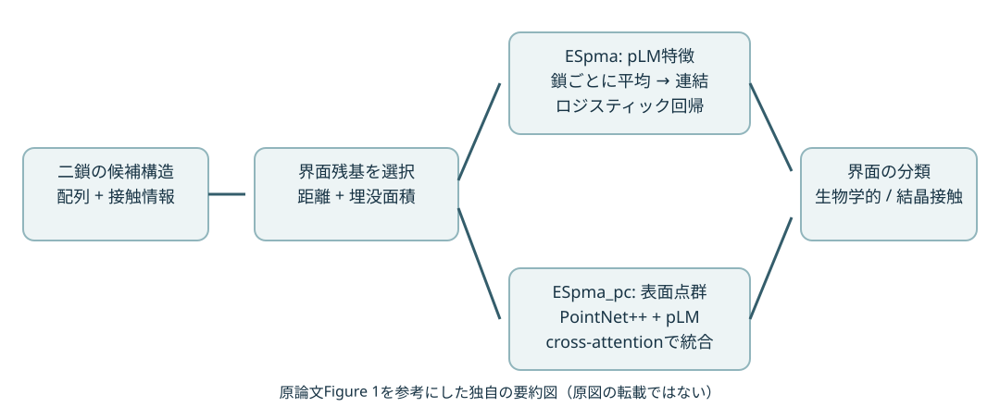
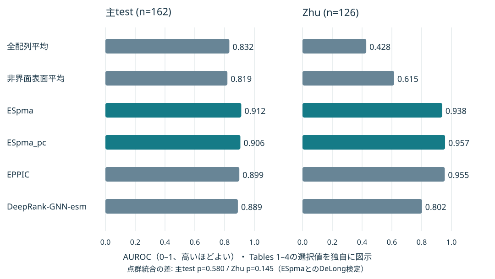

# ESpma: A method for assessing biological/non-biological interfaces using point-clouds-based structural features and protein language models

[HTMLビジュアルノート](20261030_ESpma%20A%20method%20for%20assessing%20biological%20non-biological%20interfaces%20using%20point-clouds-based%20structural%20features.html)

## まず何の論文か

ESpmaは、結晶構造で隣り合う二本のタンパク質鎖の接触面を、生物学的な相互作用か結晶パッキング由来の接触かに分類する手法である。配列から未知の相互作用相手を探すPPI予測とは問題設定が異なり、入力として候補界面を持つ立体構造が必要になる。題名にある点群とは、分子表面を三次元座標と局所的な特徴を持つ点の集合として表すことを指す。ただし、軽量版ESpmaそのものは点群を分類器へ入力しない。構造から界面残基を選び、その位置のタンパク質言語モデル（pLM）の埋め込みを鎖ごとに平均して、ロジスティック回帰に渡す。点群を使うのはPCモデルと、言語特徴と統合するESpma_pcである。この比較によって、構造の価値を「どの残基を見るか」と「表面形状を明示的に学習するか」に分けて調べている。主評価では全配列平均から界面平均へ変えるとAUROCが0.832から0.912へ上がる。一方、点群統合版は0.906で、界面平均版との差は有意でなかった。抗体研究への主な示唆は、複雑なモデルを作る前に、評価対象の界面に特徴抽出を合わせるという設計原理にある。抗体の結合成功率や親和性が改善することまで実証した論文ではない。[本文 §1–3](https://onlinelibrary.wiley.com/doi/full/10.1002/pro.70790)

## 書誌情報

- URL/DOI: [10.1002/pro.70790](https://doi.org/10.1002/pro.70790)、[PubMed / PMID 42752891](https://pubmed.ncbi.nlm.nih.gov/42752891/)
- 公開日/更新日: 初回オンライン公開2026-09-17。2026年10月号。更新日は未確認。
- 著者・所属: Sarah Nozawa、Yoshinori Fukasawa（宇都宮大学バイオサイエンス教育研究センター）、Kentaro Tomii（産業技術総合研究所・人工知能研究センター）。責任著者はYoshinori Fukasawa。
- 掲載誌: Protein Science 35(10), e70790。査読済み、Tools for Protein Science。
- リサーチ日: 2026-10-30（日本時間）
- 分類: 新着／タンパク質AI・構造界面分類

## 背景と問題設定

X線結晶構造には、生体内で機能する会合と、結晶格子を作るための接触が混在する。特に大きな結晶接触は、埋没面積や物理化学的特徴が生物学的界面と似るため、接触しているという事実だけでは判定できない。従来はPISAのような構造・エネルギー情報や、EPPICのような進化情報、DeepRank系の深層学習が用いられてきた。

pLMは各残基を周囲の配列文脈を含むベクトルへ変換するが、全配列を平均すると界面の信号が薄まる可能性がある。そこで著者らは、局在化そのものの効果と、追加の形状表現の効果を比較した。負例も実際に結晶内で実現している接触なので、無作為な非相互作用配列対とは異なる評価になる。抗体設計では、予測複合体の界面特徴をどう集約するかを考える上で参考になる。[本文 §1, §4.1](https://onlinelibrary.wiley.com/doi/full/10.1002/pro.70790)

## この論文のコアアイデア

構造情報は二段階で使える。第一は界面を選ぶための位置情報、第二は曲率や局所化学環境を学習するための表面情報である。ESpmaでは第一段階だけを使い、構造で選んだ残基について配列由来の特徴を読む。ESpma_pcでは第二段階も追加する。従って「ESpmaは配列だけで動く」と理解すると、推論に必要な入力を取り違える。

原論文Figure 1とMethodsを参考にした独自の要約図（原図の転載ではない）。出典: [Nozawa et al., Figure 1](https://onlinelibrary.wiley.com/doi/full/10.1002/pro.70790)。独自SVGのため原図の配色・配置は再現していない。

## 手法の詳細

| 項目 | 内容 |
|---|---|
| 入力 | 候補界面を含む二鎖の構造と、対応するアミノ酸配列。ASU内または結晶対称操作で得た鎖対が対象 |
| 界面定義 | 鎖間重原子距離8 Å以内の候補接触と、残基の埋没溶媒接触面積BSA約1 Ų以上を組み合わせる。FreeSASAで計算。本文には「at least」と「exceeded」の表記差がある |
| 言語特徴 | 凍結ESM-C 600M最終層。ESM-2 650M、Ankh-baseも同じ比較に使用 |
| 軽量版 | 各鎖の界面残基をmean poolingし、二鎖分を連結。正則化ロジスティック回帰で生物学的界面スコアを出す |
| 点群版 | dMaSIF由来の表面点・形状/物理化学特徴をPointNet++系で処理。FPSと近傍集約を階層的に行い全体をプール |
| 統合版 | 点群特徴と残基埋め込みを初期段階のcross-attentionで対応づけ、ニューラル分類器へ渡す |
| 学習 | pLMは再学習しない。回帰のハイパーパラメータはOptunaでvalidationに基づき選択。正則化係数の最終値は未確認 |
| 損失・最適化 | ニューラルモデルは二値交差エントロピー、Adam、学習率0.001、weight decay 0.0001、batch 24、最大50 epoch。validation lossが10 epoch改善しなければ停止 |
| 推論 | 確率出力と、閾値0.5の二値判定。ドッキング用途での校正済み確率とはみなさない |

点群は原子座標を単に全部並べることと同義ではない。この論文では分子表面上の点に局所的な属性を対応づけ、空間的に近い点をまとめて界面の形状を表す。軽量版は平均後のベクトルに座標や距離を含めず、「どの位置を平均したか」に構造情報を残す。[本文 §4.4–4.8](https://onlinelibrary.wiley.com/doi/full/10.1002/pro.70790)

数式で書けば、鎖AとBの界面残基集合をI_A、I_Bとして、

`x = concat(mean_{i∈I_A} e_i, mean_{j∈I_B} e_j)`

`z = b + w_A·mean(e_i) + w_B·mean(e_j); p = sigmoid(z)`

となる。残基別の相対スコアは`c_i = e_i·w_A`などで計算できる。ただし実際のlogitへの加算分は各鎖の残基数で割った`c_i / |I_A|`であり、切片も残る。この分解は分類器の線形性に関する説明で、残基の結合自由エネルギーや変異効果を直接推定する式ではない。さらに二鎖の連結は順序を持つので、鎖交換時の出力一致は実装で別途検証する価値がある（後者は本ノートの検討事項）。

## データセットと評価設計

| 用途 | データと規模 | 分割・注意点 |
|---|---|---|
| 学習・検証 | Baskaranら由来: 生物学的2,829、結晶接触2,921、合計5,750界面 | train/validationは80:20のランダム分割。主testとの鎖配列一致度が30%を超える学習側エントリを除外し、train/validationの6.3%が除去された |
| 主test | Duarteら由来: 前処理後162界面＝81正例＋81負例 | 学習・モデル選択に使わない。EPPIC開発時に用いたデータなので、同法について独立した外部検証とはいえない |
| 追加test | Zhuら: 137構造243界面→鎖対を確定できない8界面除外→235界面→126界面 | 元の学習・検証集合を参照して鎖レベル30%一致度で除外。最終64正例＋62負例。両クラスで鎖配列を多く共有する |
| 補助事例 | Dockgroundの1R0R、1GPW、1F6M | easy/intermediate/difficultの3例。網羅的ドッキングベンチマークではない |

取得元は[SBGrid dataset 843](https://data.sbgrid.org/dataset/843/)。学習ラベルには進化的保存に基づくアノテーションが使われるため、直接の実験測定だけで構成された教師信号ではない。主testは実験的に裏づけられた界面分類を持つ。

比較は全配列平均（baseline1）、界面と同数の非界面表面残基平均（baseline2）、ESpma、PC、ESpma_pc、既存手法。baseline2の表面条件はrASA ≥25%、抽出は3回繰り返し、AUROCの揺れは0.005未満。指標はAUROC、ACC、MCC、感度、特異度で、生物学的界面を正例とする。AUROC差は対応のあるDeLong検定で評価した。配列冗長性を低減しているが、trainとvalidationを相互にクラスタ分割したとは本文に書かれていない。抗体・VHHの件数内訳も未確認である。[本文 §4.2–4.3, §4.7, §4.9](https://onlinelibrary.wiley.com/doi/full/10.1002/pro.70790)

## 主要結果

以下はTables 1–4の必要な列だけを選んだ要約であり、表全体の転載ではない。AUROC・ACC・MCCはいずれも高いほどよい。p値は各test上でESpmaとAUROCを比較した値。

| 手法（ESM-C系） | 主test AUROC | Zhu AUROC | Zhu ACC |
|---|---:|---:|---:|
| 全配列平均 | 0.832 | 0.428 | 0.460 |
| 非界面表面平均 | 0.819 | 0.615 | 0.563 |
| ESpma | 0.912 | 0.938 | 0.802 |
| ESpma_pc | 0.906 | 0.957 | 0.865 |
| EPPIC | 0.899 | 0.955 | 0.921 |
| DeepRank-GNN-esm | 0.889 | 0.802 | 0.802 |

主testで全配列→界面平均のAUROC差は+0.080、非界面表面→界面平均は+0.093。対応するp値は0.007と0.002である。ESM-2でも全配列0.829→界面0.899、Ankh-baseでも0.812→0.892と同じ傾向が見られた。残基数を減らすだけでなく、対象界面を選ぶことに意味があると読むのが妥当である。

主testのPC単独はAUROC 0.885、感度0.889、特異度0.642。ESpmaの感度0.778、特異度0.914とは判定傾向が違う。ESpma_pcとESpmaのAUROC差は−0.006、p=0.580。Zhuでは+0.019、p=0.145で、いずれも有意差はない。ただし統合版は分類器も違うので、これは構造情報だけを一因子変更した厳密なablationではない。「形状が役立たない」と一般化する根拠にはならない。

Zhuでは同じ配列が異なる接触面に使われるため、全配列特徴では区別しにくい。そこで界面平均がAUROC 0.938を維持することが、局在化の役割を示す強い材料になる。一方、閾値0.5でのACCはEPPICが0.921で、ESpma 0.802より高い。ランキングのよさと、固定閾値での二値判定のよさを区別して読む必要がある。ESpmaとEPPICのAUROC差も有意でない（主test p=0.686、Zhu p=0.419）。

原論文Tables 1–4とFigure 2を参考にした独自の要約図（原図の転載ではない）。[出典](https://onlinelibrary.wiley.com/doi/full/10.1002/pro.70790)。横軸はAUROC 0–1、高いほどよい。ROC曲線そのものの再現ではない。

## 重要なFigure/Table

### 1. Figure 1＋Table 1: 入力の複雑さより集約範囲

- 何を示すか: 構造からの界面抽出、pLM特徴の集約、点群統合の関係と、その対照実験。
- 読み方: 同じpLM・同じ回帰を使う3種類のpoolingを比べ、モデル能力ではなく見る残基の違いに注目する。
- 主要な傾向: ESM-Cで0.832/0.819/0.912。3種類のpLMで界面平均が最良。
- なぜ重要か: ESpmaとESpma_pcを混同せず、構造を使う二つの役割を理解できる。
- Markdown/HTML内での扱い: 両形式とも独自SVGと短い要約表。
- 出典URL: [Figure 1 / Table 1](https://onlinelibrary.wiley.com/doi/full/10.1002/pro.70790)
- ライセンス確認: Open Access表示は確認。原図の再利用条件は未確認のため、原図を保存・転載しない。

### 2. Figure 2＋Tables 2–4: 局在化は再現するが点群の増益は限定的

- 何を示すか: 主testとZhuのROC、点群・既存法との性能比較。
- 読み方: まず同一test内の差を比較し、次にZhuで全配列平均が破綻することを見る。主testよりZhuの数値が高いから簡単に汎化が改善したとはいえない。
- 主要な数値: ESpmaは0.912/0.938、統合版は0.906/0.957。統合のp値は0.580/0.145。
- なぜ重要か: 多モダリティ化を自動的な改善とみなさず、追加情報の寄与を検証する例になる。
- Markdown/HTML内での扱い: 両形式とも独自のAUROC棒グラフと選択列の要約表。原ROCはリンクのみ。
- 出典URL: [Figure 2 / Tables 2–4](https://onlinelibrary.wiley.com/doi/full/10.1002/pro.70790)
- ライセンス確認: 原図の再利用条件は未確認。

### 3. Figure 4: ドッキングへ移すときの失敗条件

- 何を示すか: 3つのDockground事例について、native contact再現率fnatとモデルスコアの関係。
- 読み方: easy/intermediateでは対応があるが、difficultでは崩れる。正しくないposeから界面を選ぶと、pooling対象もずれる。
- 主要な傾向: difficultの1F6Mでは両モデルとも意味のある相関を示さない。相関係数の正確な数値は未確認なので記載しない。
- なぜ重要か: 結晶界面分類の成功を、任意の予測複合体の品質保証へ拡張できないことが分かる。
- Markdown/HTML内での扱い: 原図はリンクのみ。HTMLでは3事例の傾向カードを独自構成。
- 出典URL: [Figure 4](https://onlinelibrary.wiley.com/doi/full/10.1002/pro.70790)
- ライセンス確認: 原図の再利用条件は未確認。

全主Figure 1–4とTables 1–4の本文・キャプションを確認した。Figure 3は残基寄与と疎水性の関係を扱い、同じアミノ酸でもスコアがばらつくことを示す。ただしLeu106の値がキャプション+11.34、本文+11.04と不一致のため、この値をチャートや定量的結論には用いない。補足Figures S1–S7とTables S1–S6は一覧と説明を確認したが、ファイル本体は取得できていない。

## Code / License / Weights

- コード公開: あり。
- GitHub URL: [fukasawa-group/espma](https://github.com/fukasawa-group/espma)
- GitHub以外のコードURL: [軽量版Colab](https://colab.research.google.com/github/fukasawa-group/espma/blob/main/notebooks/inference_lr.ipynb)、[統合版Colab](https://colab.research.google.com/github/fukasawa-group/espma/blob/main/notebooks/inference.ipynb)。同一GitHubノートブックの実行入口。
- 実装種別: 公式・著者実装。論文および[研究室告知](https://c-bio.mine.utsunomiya-u.ac.jp/fukasawa/2026/09/17/産総研・人工知能研究センターとの共同研究成果/)からリンクされている。
- GitHub確認: 確認済み。調査時main SHA `73c8b2b5be05c67154e63051fc2668afc198d2c8`。
- リポジトリのライセンス: READMEにMITバッジあり。ただしツリーにLICENSEファイルがなくGitHub license APIは404。正式な条件文と重みへの適用範囲は未確認。「MIT条件文まで確認済み」とは扱わない。
- ライセンス確認元: [README](https://github.com/fukasawa-group/espma/blob/73c8b2b5be05c67154e63051fc2668afc198d2c8/README.md)、[固定SHAツリー](https://api.github.com/repos/fukasawa-group/espma/git/trees/73c8b2b5be05c67154e63051fc2668afc198d2c8?recursive=1)、[license API](https://api.github.com/repos/fukasawa-group/espma/license)。
- Hugging Face URL: ESpma専用公開物は見つからず。
- Hugging Face種別: 該当なし（専用公開物は未発見）。
- モデル重み・チェックポイント公開: あり。GitHubツリーでファイルの存在を確認。ダウンロードして推論したわけではない。
- 重み公開URL: [checkpoint/](https://github.com/fukasawa-group/espma/tree/73c8b2b5be05c67154e63051fc2668afc198d2c8/checkpoint)。`lr_esmc_nr_model.joblib`、`lr_nr_model.joblib`、`nr_pc_esmc.pth`、`nr_pc_esm.pth`。ファイル名と推論コードから対応を読み取れるが、全チェックポイントの論文表との完全対応は未確認。
- データセット公開: あり（既存ベンチマーク）。著者独自の全分割・全前処理済み特徴が完全公開されているかは未確認。
- データセットURL: [SBGrid 843](https://data.sbgrid.org/dataset/843/)、[最小サンプル](https://github.com/fukasawa-group/espma/tree/73c8b2b5be05c67154e63051fc2668afc198d2c8/test)
- 再現性メモ: GitHub Releases APIは空。READMEには投稿中という古い記載が残るが、掲載状態は出版社の2026年9月公開情報を優先する。

**実装を読むときの重要点。** [predict_ppi_esm_lr.py](https://github.com/fukasawa-group/espma/blob/73c8b2b5be05c67154e63051fc2668afc198d2c8/predict_ppi_esm_lr.py)は、界面残基を一つずつmaskして特徴を計算するモードを既定にしている。`--no_masking`は高速だが異なるforward passになると説明されている。本文Methodsの単純な「最終層埋め込み」だけではこの処理が明確でなく、再現時には学習済み重みと特徴抽出モードの整合が必要である。ESM-C 600Mの一残基は1,152次元、二鎖連結は2,304次元。ESM-2 650Mなら2,560次元で、重みに合うbackboneを選ぶ必要がある。

また、`fair-esm`とESM-C用の`esm`は同じimport名を使うため、コードは環境を分けるよう注意している。requirements.txtはfair-esm中心で、軽量推論に必要なFreeSASA等を別途確認する必要がある。点群版はdMaSIFの別途導入も必要。公開コードを静的に確認した範囲であり、モデル実行による性能再現は今回行っていない。

## 抗体研究・創薬への意味

**論文が直接示したこと:** 構造で定義された界面にpLM特徴を局在化すると、生物学的界面と結晶接触の識別に有効だった。抗体特化モデルでも、親和性推定器でもない。

**抗体研究への転用案（本ノートの解釈）:** 抗体–抗原予測構造について、全長の平均特徴と、パラトープ/エピトープに限定した平均特徴を、同じ単純分類器で比較する価値がある。CDRだけを機械的に選ぶと、非接触CDRや接触framework残基を誤って扱うため、構造上の接触範囲も対照にする。実験binder/non-binderのデータで抗原単位・配列クラスタ単位の分割を行い、ipTM等の構造信頼度に対して追加の予測価値があるかを調べるとよい。

VHH–抗原なら二鎖設定へ対応させやすいが、通常抗体のH鎖・L鎖と抗原をまとめる方法は検証が要る。同じ界面残基集合を選ぶ複数poseは、軽量版では同じ配列特徴になる。細かな配向差、衝突、水素結合、抗原の状態を区別するには別の情報が必要になる可能性がある。ドッキングスコアとして使う場合は、近いposeの選別と、未知抗原への結合の可否を別々に検証するべきである。

## 限界と注意点

**著者が示した範囲・留保**

- 点群追加のAUROC差は両testで有意でなく、統合版は構造を一因子だけ足した厳密なablationでもない。
- ドッキングは3事例のみ。大きな構造変化では失敗し、CAPRI等での大規模評価が必要とされる。
- ドッキングの確率は0/1付近に飽和し、校正された成功確率とは扱えない。
- SAEによる疎な説明特徴への変換では予測信号の一部が失われた。残基寄与を計算できても、生物物理機構の説明が完成したわけではない。

**本ノートの評価上の留保**

- 30%鎖配列フィルタは有用だが、train/validation間のクラスタ分割や、pLM事前学習データとの独立性まで保証しない。
- 主testは162、Zhuは126界面と小規模。多くの比較でp値が示されるが、多重比較補正を行った記載は未確認。非有意は同等性の証明ではない。
- EPPICの開発データとの関係、既存法の学習時フィルタの違い、サーバー/公開重み/既報スコアの混在により、すべてが同条件の再学習比較ではない。
- 結晶接触は実験的non-binderや無作為な非相互作用対と同じ負例ではない。抗体スクリーニングへそのまま置き換えられない。
- 抗体、抗原、CDR/H鎖L鎖に分けた評価、実験的結合確認、親和性測定は示されていない。
- 「秒程度」という計算時間の記述は、現環境の保証ではない。masked抽出や構造前処理を含む実測条件は再確認が必要。
- 原図の再利用条件、コードの正式LICENSE、重み・基盤pLMの利用条件は別に確認する必要がある。

## この論文を読む上での前提知識

- **生物学的会合と結晶接触:** 結晶中で近い分子が、細胞内でも機能的に結合しているとは限らない。
- **SASA/BSA:** 溶媒に触れる面積と、複合体形成で隠れる面積。界面残基を定義する手がかりになる。
- **pLM埋め込み:** 残基を配列文脈付きの数値ベクトルとして表したもの。同じアミノ酸でも周囲の配列で異なる。
- **Mean pooling:** 複数ベクトルを平均して固定長へ集約する操作。選択範囲以外の配置情報や残基間対応は消える。
- **点群とPointNet++:** 不規則な表面点集合から、近傍の形状を階層的にまとめる方法。画像の規則格子とは異なる。
- **AUROCと閾値:** AUROCはスコアの順位づけを評価する。ACCや感度は選んだ閾値に依存する。
- **配列冗長性:** 近縁タンパク質が学習とtestの両方に入ると過大評価になりうる。鎖レベルの一致度フィルタはその対策の一つ。

## 今回この1報を選んだ理由

ユーザー指定のESpmaに一致し、点群表現の役割を整理できる一次論文である。2026年9月公開の新着だが、学習上の価値は「単純な対照で複雑化の必要性を測る」点にもある。公式実装、Colab、重みがあり、概念から実装の入口までつなげられる。

## 読む優先度

**High。** PPI表現・界面pooling・点群の役割を対照実験から学ぶのに適している。抗体の実用的なbinder判定が目的なら、抗体特化の外部評価を追加して読む必要がある。

## 自分用メモ

- 深掘り: masked特徴抽出と本文の対応、二鎖入替えの対称性、凍結pLMと回帰の正則化、全分割リスト。
- 関連して読む: 本文で比較されるDeepRank-GNN-esm、局所表面表現のdMaSIF、PointNet++。本文の参考文献から原著へ進む。
- 実装の入口: まず軽量版Colab、`predict_ppi_esm_lr.py`、`interface_analyzer.py`、`plm_backend.py`を対応づける。重みを選ぶ前に特徴次元を確認する。
- 次の検証案: 同一の抗体・抗原ペアで界面を変えたときだけスコアが変わるかを調べ、構造信頼度の効果と切り分ける。
- Obsidianリンク候補: [[タンパク質言語モデル]]、[[界面局在化]]、[[点群]]、[[抗体抗原結合予測]]、[[データリーク]]。

## 関連キーワード

ESpma / ESpma_pc / ESM-C / ESM-2 / Ankh / dMaSIF / PointNet++ / biological assembly / crystal contact / FreeSASA / interface pooling / geometric deep learning

## 検索ログ

- 実行日: 2026-10-30。ユーザー指定の1報のみ採用。今週の一般的な新着選定は実施せず、新着・基盤の比率調整も行わない。
- クエリ: `ESpma protein protein interaction point cloud`、`ESM PPI ESPMA point cloud protein interaction`、`"ESpma" Nozawa github`。
- 同定: 出版社DOI、PubMed、研究室告知が一致。対象はNozawa/Tomii/Fukasawa、Protein Science、10.1002/pro.70790。
- HTML本文: [Wiley全文](https://onlinelibrary.wiley.com/doi/full/10.1002/pro.70790)をブラウズツールで確認。AbstractだけでなくResults、Methods、主Figureのキャプション、Tables 1–4を精読。
- PDF: 本文PDFは未取得。補足PDFとXLSXは出版社リンクを確認したが取得失敗。未読の補足表の正確な数値は補完しない。
- PMC: [PMC13584886](https://pmc.ncbi.nlm.nih.gov/articles/PMC13584886/)はアクセス時に確認画面となり、アクセス制限を回避せず、出版社HTMLを使用。
- 原図/ライセンス: OA表示のみ確認。`"10.1002/pro.70790" "Creative Commons"`検索で条件を確定できず、原図を保存しない。独自SVGを2点作成。
- コード確認: 公式GitHubのREADME、全ファイルツリー、`predict_ppi_esm_lr.py`、`plm_backend.py`、`interface_analyzer.py`、`model/piaco2_architecture.py`、requirements.txtを確認。固定SHAは上記。
- 重み確認: GitHub checkpointの4ファイル。Releases APIは空。専用Zenodo/Google DriveリンクはREADME・本文・ツリー内で見つからず。
- Hugging Face: `"ESpma" site:huggingface.co`で専用model/dataset/spaceを発見できず。基盤pLMの重みとESpmaの学習済み分類器は区別した。
- データ: 論文の[SBGrid 843](https://data.sbgrid.org/dataset/843/)リンクとGitHub testサンプルを確認。SBGrid全データの取得・再処理は未実施。
- 再現性の到達点: 一次本文と公開コードの静的調査。補足実体、全チェックポイントのロード、ベンチマーク再実行は未実施。
