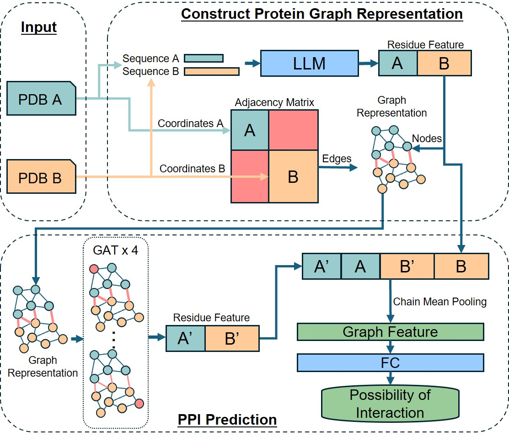
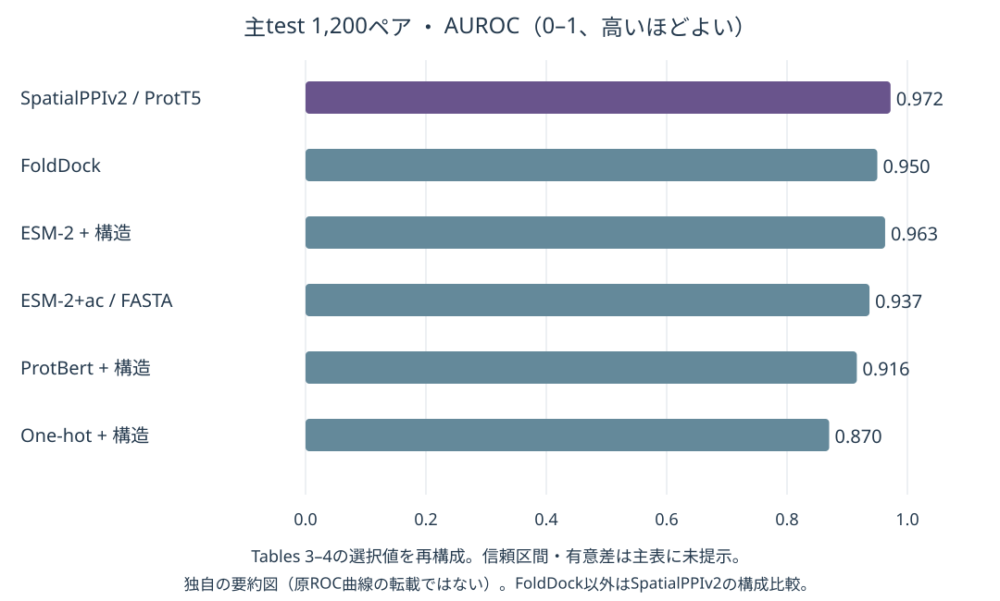
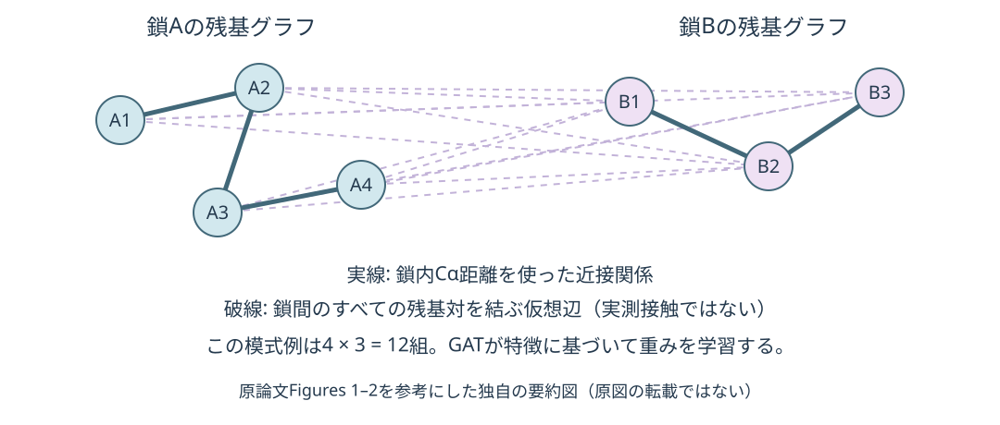

# SpatialPPIv2: Enhancing protein–protein interaction prediction through graph neural networks with protein language models

[HTMLビジュアル精読ノート](20261030_SpatialPPIv2%20Enhancing%20protein-protein%20interaction%20prediction%20through%20graph%20neural%20networks%20with%20protein%20language%20models.html) / [前作SpatialPPIのノート](20261020_SpatialPPI%20Three-dimensional%20space%20protein-protein%20interaction%20prediction%20with%20AlphaFold%20Multimer.md)

## まず何の論文か

SpatialPPIv2は、大上研のWenxing Huと大上雅史による、二つのタンパク質が相互作用するかを予測するモデルである。前作SpatialPPIはAlphaFold Multimerで複合体を予測し、その界面を3D格子にしてCNNへ渡していた。v2は各タンパク質を残基グラフとして表し、タンパク質言語モデル（pLM）とGraph Attention Network（GAT）を組み合わせる。構造がある場合でも、二分子をドッキングした複合体の相対配置は必要ない。各タンパク質内の近接関係を構造から作り、異なるタンパク質間の全残基対に仮想的な辺を置く。GATは、この密な接続を通じて相手の残基特徴を参照し、相互作用を判定する。構造がないときには、ESM-2の予測接触マップで鎖内グラフを作るESM-2+acも使える。主学習は約117万ペアで、主testの1,200ペアにおいて最良構成の正解率は0.910、AUROCは0.972、APは0.973だった。ただし学習側の負例は無作為な組合せ、test側の負例はNegatome由来であり、その難しさと意味は同じではない。抗体研究には候補の高速なペア選別という接続がある一方、結合姿勢の正しさや親和性を出すモデルではない。前作より大幅に設計が変わった論文として、入力表現、評価設計、公開コードを分けて理解するのが重要である。[原著 §1–3](https://doi.org/10.1016/j.csbj.2025.01.022)

## 書誌情報

- URL/DOI: [10.1016/j.csbj.2025.01.022](https://doi.org/10.1016/j.csbj.2025.01.022)
- 本文: [Europe PMC](https://europepmc.org/articles/PMC12621273)、[公開全文XML](https://www.ebi.ac.uk/europepmc/webservices/rest/PMC12621273/fullTextXML)、[PubMed 41255828](https://pubmed.ncbi.nlm.nih.gov/41255828/)
- 公開日/更新日: 出版社ページのオンライン公開は2025-01-28。受理2025-01-23。PMCの書誌行は2025-01-23で、受理日とオンライン公開日の表記差を区別する。改訂版の公開日は未確認。
- 著者・所属: Wenxing Hu、Masahito Ohue（大上雅史、責任著者）。東京科学大学 情報理工学院（School of Computing, Institute of Science Tokyo）。
- 掲載誌: Computational and Structural Biotechnology Journal, 27, 508–518（2025）。査読済み原著。
- リサーチ日: 2026-10-30（日本時間）
- 分類: モデル起点／基盤／タンパク質間相互作用予測

## 背景と問題設定

PPI予測は、タンパク質の機能や創薬標的を調べる入口になる。実験は高価で、候補ペア数は分子数の二乗で増える。配列法は使いやすいが、折りたたみ構造の近接関係を直接使いにくい。構造法は、実験構造の不足と複合体予測の計算時間が制約になる。加えてAlphaFoldが高信頼度の複合体を出しても、実際の結合を保証しない。

v2は、複合体を一件ずつ予測する負担を避けながら、各タンパク質の配列と鎖内構造を使うことを狙う。相手が変わっても各鎖の特徴は再利用できる。これは前作の界面画像分類を速くしただけではなく、「二分子の相対配置が分からない段階で相手との関係を学習する」問題への変更である。[原著 Introduction, §2.3–2.4, Conclusion](https://europepmc.org/articles/PMC12621273)

## この論文のコアアイデア

**鎖内は構造由来、鎖間は仮想的な全結合**とする。鎖Aの残基iと鎖Bの残基jが実際に接触しているかを入力せず、すべての組合せについて情報をやり取りできるようにする。注意機構が特徴の組合せに応じた重みを付け、二鎖を別々に平均して得た特徴からペアのスコアを出す。原子レベルの界面形状やエネルギーを直接評価しているわけではない。

出典: Hu & Ohue, SpatialPPIv2, Figure 1相当の公式ワークフロー図。[論文](https://doi.org/10.1016/j.csbj.2025.01.022) / [著者配布画像](https://github.com/ohuelab/SpatialPPIv2/blob/67c60793f89036241de0d9dd9fc83535de6d1b9f/assets/fig.jpg)。© 2025 The Authors、[CC BY 4.0](https://creativecommons.org/licenses/by/4.0/)。画像は改変せず、表示サイズのみ調整。論文のライセンスは全文XMLのpermissionsで確認した。

### 前作・ESpmaとの違い

| 観点 | SpatialPPI（2024） | SpatialPPIv2（本論文） | ESpma（別論文） |
|---|---|---|---|
| 主な入力 | 予測複合体の界面 | 各タンパク質の構造＋配列。配列のみの経路もある | 候補界面を持つ構造＋配列 |
| 空間表現 | 原子の3D格子 | 残基グラフ。鎖間は全結合 | 界面を選んでpLM平均。拡張版は表面点群 |
| 推論に相対配置が必要か | 必要 | 不要 | 界面を定義するため必要 |
| 主なタスク | PPI / non-PPI | PPI / non-PPI | 生物学的界面 / 結晶接触 |

この表は各論文の問題設定を本ノートで整理したもの。三者の数値を同一ベンチマークの順位として並べない。[v1ノート](20261020_SpatialPPI%20Three-dimensional%20space%20protein-protein%20interaction%20prediction%20with%20AlphaFold%20Multimer.md) / [ESpmaノート](20261030_ESpma%20A%20method%20for%20assessing%20biological%20non-biological%20interfaces%20using%20point-clouds-based%20structural%20features.md)

## 手法の詳細

| 項目 | 内容 |
|---|---|
| 入力 | 構造経路は二つのPDB/mmCIFと鎖ID。配列経路は二つのFASTA |
| ノード特徴 | 残基ごとのProtT5、ProtBert、ESM-2埋め込み。one-hotを対照に使用 |
| 鎖内の辺 | Cα間距離8 Å未満の残基対。公開コードは`<=8`かつ`>0`で接続。境界に表記差がある |
| 鎖間の辺 | 全残基対を接続。辺の属性は実距離ではなく8を設定 |
| GAT | 4層、各4 head、headの出力は平均。特徴幅はD/2 → D/4 → D/2 → D。中間層にbatch normalizationとReLU |
| 出力への集約 | GAT出力と元のpLM特徴を各残基で連結。鎖ごとにmean poolingし二鎖を連結。4D次元から線形層とsigmoidで1スコア |
| 学習目的 | 正例1・負例0の二値交差エントロピー |
| 最適化 | Adam、学習率0.0001、10 epochs、batch 8、4 batchの勾配蓄積（実効batch 32） |
| pLMの扱い | 公開特徴抽出コードはeval＋no_gradで計算。pLM全体のfine-tuningではない |
| 配列のみの経路 | ESM-2+ac。ESM-2の鎖内contact確率>0.5を辺へ変換し、鎖間は同じ全結合 |

ProtT5-XL-UniRef50はTable 2で3B、出力1,024次元。ProtBertは420M・1,024次元、ESM-2は650M・1,280次元。モデル比較では表のパラメータ数と、下流GATの学習可能パラメータ数を混同しない。ProtT5は配列モデルのencoder特徴を利用する。[原著 §2.2–2.4](https://europepmc.org/articles/PMC12621273)

ESM-2+acは、ESM-2特徴と実験構造で学習した重みを、推論時には予測contact graphとともに使う経路である。したがって「学習から推論まで構造を一度も使わない別モデル」とは読まない。

鎖Aの残基数n、鎖Bの残基数mなら、鎖間辺だけで双方向に約2nm本となる。3D格子の制約は避けられるが、長い抗原で計算量やメモリが増えないわけではない（本ノートによる構造からの帰結）。また、鎖間の実距離をすべて同じ値に置き換えるため、各鎖内の構造が同じなら片側の平行移動・回転だけでは入力グラフは変わらない。**このモデルは同じ二分子のドッキング姿勢を順位づけする仕組みではない。**

## データセットと評価設計

PINDERの構造対を正例に用い、長さと接触数でフィルタする。本文の範囲表現は35–300残基で、公開生成コードは両鎖について`35 < length < 300`、Cα距離8 Å未満の接触数`>8`を要求する。長い全長タンパク質や通常抗体＋全長抗原がそのまま主評価の対象範囲に入るとはいえない。

| 集合 | 正例 | 負例 | 合計 |
|---|---:|---:|---:|
| train | PINDER train由来583,516 | 同じsplit内からランダム抽出583,516 | 1,167,032 |
| validation | PINDER val由来1,081 | 同じsplit内からランダム抽出1,081 | 2,162 |
| test | PINDER test由来600 | Negatome manual stringent 168＋pdb stringent 432 | 1,200 |

学習・検証のランダム負例はBioGRIDで既知の相互作用を除く。ただし「DBに相互作用記録がない」は実験的な非結合の証明ではなく、未発見の正例が混ざりうる。test負例でも、168件は文献由来の非相互作用、432件は構造複合体に共存するが直接接触しないペアであり、全600件が同じassayで測定されたnon-binderではない。

分割はPINDERの界面クラスタリング・deleakingを利用する。本文は界面の類似条件をiRMS<5.0、IS-score>0.3、log(P-value)<−9.0と記載する。これは単純なペアランダム分割より配慮がある一方、抗体系列・抗原単位での独立性や、すべての鎖が学習とtestで未見であることとは異なる。抗体/VHHの内訳と専用testは未確認。

主比較はTopsy-Turvy、D-SCRIPT、Struct2Graph、GNN-PPI、FoldDock。前二者は公開済み重み、後二者は著者らが再現手順に従って学習したものとされ、すべてが同じ学習集合で再学習された比較ではない。評価指標はACC、precision、recall、F1、AP、AUROC。FoldDockのpDockQは既報閾値0.23を使い、本文は当該testでの最適値0.21ならACC 0.894と補足するが、testで最適化した閾値を独立評価とみなさない。[原著 §2.1, §2.5, §3.3 / Tables 1, 4](https://europepmc.org/articles/PMC12621273)

## 主要結果

### 主test: 言語モデルと構造経路の比較（Table 3）

| 構成 | ACC ↑ | AP ↑ | AUROC ↑ |
|---|---:|---:|---:|
| ProtT5＋構造グラフ | 0.910 | 0.973 | 0.972 |
| ProtBert＋構造グラフ | 0.823 | 0.922 | 0.916 |
| ESM-2＋構造グラフ | 0.891 | 0.967 | 0.963 |
| ESM-2+ac（推論時FASTAのみ） | 0.858 | 0.947 | 0.937 |
| One-hot＋構造グラフ | 0.762 | 0.862 | 0.870 |

ProtT5とone-hotの差はACC +0.148、AP +0.111、AUROC +0.102。配列文脈を持つ特徴の効果を支持する。ESM-2+acは構造経路より下がるが、構造なしの入力でも一定の識別能力を保つ。これはpLMとグラフを同時に用いた結果で、GATを除いたpLM-only対照による寄与分離までは確認できない。

### 主test: 既存法との比較（Table 4）

| 手法 | ACC ↑ | AP ↑ | AUROC ↑ | Recall ↑ |
|---|---:|---:|---:|---:|
| SpatialPPIv2 | 0.910 | 0.973 | 0.972 | 0.942 |
| FoldDock | 0.888 | 0.954 | 0.950 | 0.875 |
| Struct2Graph | 0.812 | 0.876 | 0.891 | 0.813 |
| GNN-PPI | 0.771 | 0.801 | 0.833 | 0.858 |
| Topsy-Turvy | 0.774 | 0.865 | 0.867 | 0.678 |
| D-SCRIPT | 0.704 | 0.826 | 0.824 | 0.490 |

FoldDockに対してACC +0.022、AP +0.019、AUROC +0.022。主testの混同行列はTN=527、FP=73、FN=35、TP=565で、感度565/600=0.942、特異度527/600=0.878となる。precisionは0.886で、FoldDockの0.899が上回る。全指標で一様に優れているわけではない。表の比較に信頼区間や反復seed間の分散、有意差検定は付いておらず、差の確実性は別途評価が必要。

原論文Tables 3–4を参考にした独自の要約図（原図の転載ではない）。[出典](https://doi.org/10.1016/j.csbj.2025.01.022)。横軸はAUROC 0–1、高いほどよい。ROC曲線の再現ではなく、選択した報告値の比較。

### 予測構造、速度、100万ペア評価

Figure 5ではAF3・AF2・ESMFoldの予測構造でも評価し、AF3/AF2では実験構造と近い性能、ESMFoldでは低下と報告する。図中の各AP値は今回の取得XMLでは数値として得られないため、転記しない。各鎖の構造の質に依存するが、複合体の相対配置そのものを使うという意味ではない。

TSUBAME 4.0のH100を備える環境で、特徴を事前計算すると約120ペア/秒、埋め込み計算込みでは平均0.5秒/ペアと報告される。比較対象の複合体予測はAF3が平均23分、AF2が96分で、DB検索を含む。前処理済みの推論時間と、DB検索を含む全処理時間を同条件の速度差として割り算しない。手元PCで同じ速度を保証する値でもない。

Table 5はtrain/validationを入れ替え、2,162ペアで学習して1,167,032ペアを評価した追加実験。ランダム負例の正答率0.957、正例全体0.942、同一/類似タンパク質の正例0.997、異なるタンパク質の正例0.906だった。主testの負例正答率0.878との差は、ランダム負例とNegatome負例の難しさの違いを示す。大量testでも、負例の意味や分布が変わる点は残る。[原著 §2.5, §3.2–3.4](https://europepmc.org/articles/PMC12621273)

## 重要なFigure/Table

### 1. Figures 1–2: 鎖内構造と鎖間の仮想接続

- 何を示すか: 配列特徴、鎖内隣接行列、二鎖間の全結合、4層GAT、元特徴との連結、chain mean poolingの関係。
- 読み取り方: 隣接行列の対角ブロックは各鎖の構造、非対角ブロックは観測された界面ではなく全結合。最終平均は鎖を区別して行う。
- 主要な傾向: 構造内の近接は8 Å基準、鎖間は仮想値8を設定。GATの各層4 heads。
- なぜ重要か: 複合体予測なしで動く理由と、poseの正しさを判定できない理由が同時に分かる。
- Markdown/HTML内での扱い: Figure 1相当の著者配布原図を両形式に埋め込み。Figure 2の概念は独自模式図でも補足。
- 出典URL: [原著](https://europepmc.org/articles/PMC12621273)、[公式画像](https://github.com/ohuelab/SpatialPPIv2/blob/67c60793f89036241de0d9dd9fc83535de6d1b9f/assets/fig.jpg)
- ライセンス確認: 確認済み、CC BY 4.0。独自模式図は原図の転載ではない。

Figures 1–2とMethodsを参考にした独自の要約図（原図の転載ではない）。[出典: Hu & Ohue](https://doi.org/10.1016/j.csbj.2025.01.022)。辺の配置は概念説明用であり、特定の実分子の座標・注意重みを表していない。

### 2. Figure 3＋Tables 3–4: 文脈特徴と比較性能

- 何を示すか: pLMごとのROC/PR曲線と、既存法との性能差。
- 読み取り方: APとAUROCを分け、固定閾値でのprecision/recallも確認する。APは陽性率に影響されるので別データセット間の直接比較を避ける。
- 主要な数値: ProtT5 AUROC 0.972、one-hot 0.870、ESM-2+ac 0.937。FoldDockは0.950。
- なぜ重要か: 高精度構成と入力の簡便さの交換条件が分かる。
- Markdown/HTML内での扱い: 独自棒グラフと必要列のみの要約表。原ROC/PR曲線はリンクのみ。
- 出典URL: [原著 Figure 3 / Tables 3–4](https://europepmc.org/articles/PMC12621273)
- ライセンス確認: 確認済み、CC BY 4.0。今回は再構成図を使用。

### 3. Figure 5＋Table 5: 構造予測と評価分布の限界

- 何を示すか: Figure 5は予測構造・時間・界面指標の分布・PPI分類。Table 5は学習と検証を入れ替えた大規模評価。
- 読み取り方: 予測構造の信頼度とPPI判定を区別し、ランダム負例での高い正答率をNegatome評価へ読み替えない。
- 主要な数値: 負例正答率は大規模ランダム評価0.957、主test 0.878。同じ/類似の正例0.997、異なる正例0.906。
- なぜ重要か: testの件数が増えるだけでは、実験候補の選別性能は保証されない。
- Markdown/HTML内での扱い: 両形式で選択値と説明、原図はリンクのみ。HTMLは分布の違いを注意カードにする。
- 出典URL: [原著 Figure 5 / Table 5](https://europepmc.org/articles/PMC12621273)
- ライセンス確認: 確認済み、CC BY 4.0。

主Figures 1–6とTables 1–5の本文・キャプションを全文XMLで確認した。Figure 4はAF3が非相互作用ペアにも高信頼な接触を予測する例。Figure 6は2ペアの注意重みの可視化で、原子レベル接触や変異hotspotを検証したものではない。Figure 1の画像実体は目視確認済み。他の図の画像実体と図中のみの数値は未確認。取得XMLにSupplementaryの項目はなく、別補足資料は見つからず。

## Code / License / Weights

- コード公開: あり。
- GitHub URL: [ohuelab/SpatialPPIv2](https://github.com/ohuelab/SpatialPPIv2)
- GitHub以外のコードURL: [公式Colab](https://colab.research.google.com/github/ohuelab/SpatialPPIv2/blob/main/demo/SpatialPPIv2_Colab_Example.ipynb)。GitHubノートブックの実行入口。
- 実装種別: 公式・著者実装。[大上研業績一覧](https://www.li.comp.isct.ac.jp/en/publications)にも論文・コードのリンクあり。
- GitHub確認: 確認済み。調査時main SHA `67c60793f89036241de0d9dd9fc83535de6d1b9f`。
- リポジトリのライセンス: Apache License 2.0。
- ライセンス確認元: [LICENSE本文](https://github.com/ohuelab/SpatialPPIv2/blob/67c60793f89036241de0d9dd9fc83535de6d1b9f/LICENSE)、README、GitHub metadataが一致。論文・FigureのCC BY 4.0とは区別。
- Hugging Face URL: SpatialPPIv2専用のmodel/dataset/spaceは見つからず。使用する基盤モデルは[Rostlab/prot_t5_xl_uniref50](https://huggingface.co/Rostlab/prot_t5_xl_uniref50)、[Rostlab/prot_bert](https://huggingface.co/Rostlab/prot_bert)、[facebook/esm2_t33_650M_UR50D](https://huggingface.co/facebook/esm2_t33_650M_UR50D)。これらはSpatialPPIv2の分類器そのものではない。
- Hugging Face種別: model（基盤モデル。公式コードの識別子を確認）。各model cardの最新条件は未精査。
- モデル重み・チェックポイント公開: あり。GitHubツリーで存在を確認。
- 重み公開URL: [checkpoint](https://github.com/ohuelab/SpatialPPIv2/tree/67c60793f89036241de0d9dd9fc83535de6d1b9f/checkpoint)。`SpatialPPIv2_ProtT5.ckpt`、`SpatialPPIv2_ESM.ckpt`が推論コードの読込先。別に`ProtT5.ckpt`もあるが対応する実験は未確認。
- データセット公開: 元データと生成コードあり。リポジトリのdatasets/は`.gitkeep`のみで、論文の最終CSV一式は同梱されていない。
- データセットURL: [PINDER](https://github.com/pinder-org/pinder)、[BioGRID 4.4.238](https://downloads.thebiogrid.org/Download/BioGRID/Release-Archive/BIOGRID-4.4.238/)、[Negatome 2.0](https://mips.helmholtz-muenchen.de/proj/ppi/negatome/)、[生成スクリプト](https://github.com/ohuelab/SpatialPPIv2/blob/67c60793f89036241de0d9dd9fc83535de6d1b9f/scripts/dataset_generator.py)。元データ全件は今回未取得。
- 再現性メモ: READMEはPINDER release 2024-02、Docker/Apptainer/Condaを案内。PyTorch 2.2系、PyG 2.5.1、transformers 4.40.2等の指定がある。Releases APIは空で、重みはリポジトリ内に置かれる。

### 実装を確認して分かった注意点

1. **除外処理の片側重複:** `dataset_generator.py`の`--exclude`処理は`uniprot_a.isin(exclude) | uniprot_a.isin(exclude)`となっており、同じ列を二度参照する。コードどおりではB側だけに除外対象があるペアを除けない。実際の論文実験で修正済みコードを使ったか、どのtest overlapが残るかは未確認なので、「報告性能にリークがあった」とまでは断定しない。
2. **データ生成の再現性:** ランダム負例生成は当該スクリプト内でseedを設定しておらず、最終splitの全CSVも配布されていない。設定ファイルのseed=2032だけで、別プロセスの生成まで同じになるとは限らない。
3. **距離属性の扱い:** `build_data`は距離を`edge_attr`へ入れる。一方、GATConvの生成で`edge_dim`は明示されていない。距離をどの形で注意計算へ反映するかはPyG 2.5.1での実行確認が必要。隣接関係が距離で変わる点はコードから確認できる。
4. **使い方:** `inference.py --A A.pdb --chain_A A --B B.pdb --chain_B B`で構造経路、二つのFASTAならESM-2+acへ切り替わる。初回に基盤pLMを取得する。通常抗体のH/L鎖をどうまとめるかはCLIの単鎖入力から自動的に決まらない。

確認元: [model.py](https://github.com/ohuelab/SpatialPPIv2/blob/67c60793f89036241de0d9dd9fc83535de6d1b9f/utils/model.py)、[dataset.py](https://github.com/ohuelab/SpatialPPIv2/blob/67c60793f89036241de0d9dd9fc83535de6d1b9f/utils/dataset.py)、[生成処理](https://github.com/ohuelab/SpatialPPIv2/blob/67c60793f89036241de0d9dd9fc83535de6d1b9f/scripts/dataset_generator.py)、[inference.py](https://github.com/ohuelab/SpatialPPIv2/blob/67c60793f89036241de0d9dd9fc83535de6d1b9f/inference.py)。静的調査であり、重みロード・全ベンチマーク再実行は今回未実施。

## 抗体研究・創薬への意味

**直接示されたこと:** 一般的な二鎖PPIについて、pLMと鎖内構造グラフを用いた分類が有効だった。複合体予測を前提にしないため、多数の候補ペアを前段で選ぶ用途と相性がよい。

**抗体への転用案（本ノートの解釈）:** VHHと抗原ドメインの組合せを、重い複合体予測に進める前にスクリーニングする候補手法になる。ただし訓練時の長さ制限、抗体データの内訳、近い抗体系列の効果を確認し、抗原・系列を分けたbinder/non-binderで再評価する必要がある。通常の抗体ではH/L二鎖と抗原を扱うため、単鎖ペア設計をそのまま適用する前に、Fv表現や入力構造の扱いを検証する。

ESpmaは構造で特定した「その界面」を評価し、v2は相対配置を与えず「その二分子の組合せ」を評価する。両者は接続できる可能性があるが、同じ役割のモデルではない。v2のattentionが高い残基を、そのままエピトープや変異hotspotとして採用することも検証を要する。

実験的には候補のbinder率、PR曲線、実験予算に応じたprecision@k、未知抗原への汎化を重視する。主testは陽性率50%だが、実際の探索で陽性率が低い場合、AUROCが同じでも候補中の偽陽性率は大きくなりうる。結合の可否とKd、発現量、凝集性、機能活性は別の目的変数である。

## 限界と注意点

**著者が述べる限界・観察**

- 学習負例の無作為抽出は、実験的な非相互作用より品質が低い可能性がある。実験・構造由来の負例は実際に難しい。
- 鎖間全結合は計算とメモリを増やす。ESMFoldの構造品質低下は分類へ影響した。
- 多数のパラメータを持つ機械学習の誤判定は解釈が難しい。類似配列の参照がある場合には類似性に基づく方法が有利な場面がある。

**本ノートの評価・再現性上の留保**

- v1のACC 0.818とv2の0.910は異なるデータ・分割・学習規模の結果。単純な9.2ポイント改善の証明として扱わない。
- 元データの界面クラスタ分割は評価できるが、公開コードの片側除外重複と最終CSVの不在により、全test overlapの再検証は残る。
- GATや仮想鎖間辺を除いた対照が主表にないため、pLM単独に対するGATの純粋な増益は未確定。
- Attention可視化は正負2ペアの例。残基レベルの説明の妥当性や、結合機構の因果的証明ではない。
- 抗体特化の評価、前向きwet実験、親和性、変異による結合喪失の系統的検証は示されていない。
- スコアの確率校正と、実際の低陽性率スクリーニングでの閾値は別途検証が必要。
- 両鎖の連結順は固定した表現であり、A/B入替えに対する出力の一致も実行時の確認項目になる。
- 論文・コード・基盤pLM・元データの利用条件は別々に確認する。今回、基盤モデルや全データのライセンスまでは精査していない。

## この論文を読む上での前提知識

- **残基グラフ:** 残基を点、関係を辺として表す。ここでは鎖内構造と仮想鎖間接続を区別する。
- **GAT:** 近隣ノードから受け取る情報の重みを、特徴に応じて学習するネットワーク。注意値は実際の原子間距離ではない。
- **pLM:** 配列を文脈付きベクトルに変換するモデル。残基の種類だけのone-hotとは情報量が異なる。
- **Chain mean pooling:** 鎖AとBを分けて平均する集約。単に全残基を一つに平均する操作とは異なる。
- **接触マップ:** 各残基対が近接するかを並べた行列。ESM-2+acでは鎖内の接触を予測し、二鎖のドッキングは行わない。
- **AUROCとAP:** AUROCは正負の順位分離、APはprecision-recallの関係を評価する。APは陽性率の影響を受ける。
- **負例とデータリーク:** 未記録のペアを負例とすることと、実験的に非結合と確かめることは異なる。近縁例がsplitをまたぐと評価が高く見える可能性がある。

## 今回この1報を選んだ理由

ユーザーが指定した大上研のSpatialPPIv2に一致し、既存のv1ノートとつながるため。2025年のモデル起点の論文として、複合体依存の画像表現から、pLM・残基グラフによる高速なペア分類へ設計を変えた点を学べる。コード、重み、Colab、データ生成手順があり、論文の主張を実装と照合する価値も高い。

## 読む優先度

**High。** v1と合わせると、複合体の品質評価とPPI分類の違い、画像・グラフ・配列特徴の役割を整理できる。抗体で実用する場合は、専用の分割と実験ラベルによる外部検証を追加する前提で読む。

## 自分用メモ

- 深掘り: 最終test CSV、除外対象一覧の両鎖照合、GATConvのedge_attr利用、鎖順交換、長鎖でのメモリ。
- 次の比較: 同じ抗体データ分割でpLM平均＋回帰、pLM＋GAT、構造信頼度、ESpma型界面平均を対照にする。
- 実装の入口: 公式Colab → inference.py → utils/dataset.py → utils/model.py。最初は配布demoで動作を確かめ、全データ再学習はその後に行う。
- 関連論文: SpatialPPI、ESpma、PINDER、Struct2Graph、D-SCRIPT/Topsy-Turvy。後続論文の別ベンチマーク数値を本論文の値と混在させない。
- Obsidian: [[SpatialPPI]]、[[Graph Attention Network]]、[[PINDER]]、[[タンパク質言語モデル]]、[[抗体抗原結合予測]]。

## 関連キーワード

SpatialPPIv2 / Ohue Lab / 大上研 / ProtT5 / ESM-2+ac / residue graph / chain mean pooling / fictional edges / PINDER / Negatome / BioGRID

## 検索ログ

- 実行日: 2026-10-30。ユーザー指定の1報を採用し、他論文を追加採用しない。新着枠ではなく、v1と対にして読むモデル起点の論文として選んだ。
- 同定クエリ: `SpatialPPIv2 Ohue protein interaction`、`SpatialPPI v2 大上 論文`。研究室業績一覧・GitHub・DOIで照合。
- 一次本文: [Europe PMCの正式公開全文API](https://www.ebi.ac.uk/europepmc/webservices/rest/PMC12621273/fullTextXML)を取得し、Introduction、Methods、Results、Conclusion、Tables 1–5、Figures 1–6の全キャプションを確認。Abstractや検索スニペットのみには依存しない。
- アクセス状況: PMC通常ページは確認画面、ScienceDirectとSPJの通常取得は403となったため、公開アーカイブEurope PMCを利用。アクセス制限の回避はしていない。本文PDFは未取得。
- 日付: [出版社書誌ページ](https://spj.science.org/doi/10.1016/j.csbj.2025.01.022)の検索索引にオンライン公開2025-01-28、受理2025-01-23を確認。PMC書誌行の日付と区別した。
- 図/ライセンス: 全文XMLのpermissionsでCC BY 4.0を確認。著者公式GitHubのassets/fig.jpgをFigure 1相当として保存・目視確認し、出典と条件を付記。Figures 2–6の画像実体は未取得。独自SVGを2点作成。
- 補足: 取得した全文XMLにsupplementary-material要素なし。別補足PDF・表は見つからず。
- コード確認: `ohuelab/SpatialPPIv2`、README、LICENSE、再帰tree、config/default.yaml、utils/model.py、utils/dataset.py、utils/tool.py、utils/ctrl.py、inference.py、scripts/dataset_generator.py、scripts/exclude.txt。確認SHAは上記。
- 重み確認先: GitHub checkpointの3ファイル、inference.pyの読込先。GitHub Releases APIは空。READMEに専用Zenodo/Google Driveリンクは見つからず。
- Hugging Face検索: `"SpatialPPIv2" site:huggingface.co`で専用公開物を発見できず。上記の基盤pLM識別子は公式コード・READMEから記録した。
- 元データ: PINDER release 2024-02、BioGRID 4.4.238、Negatome 2.0を本文/README/コードで確認。大規模元データの取得は未実施。
- 再現性の到達点: 一次本文と公式コードの静的照合、Figure 1実体の確認。モデル推論、重みロード、生成データ全件照合、ベンチマーク再実行は未実施。
