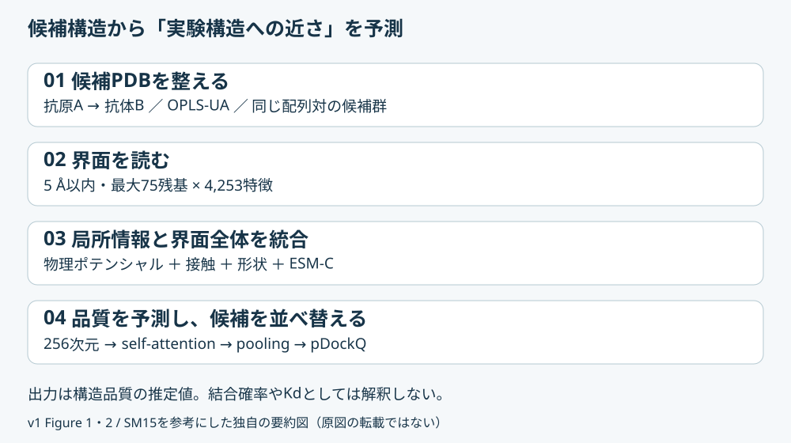
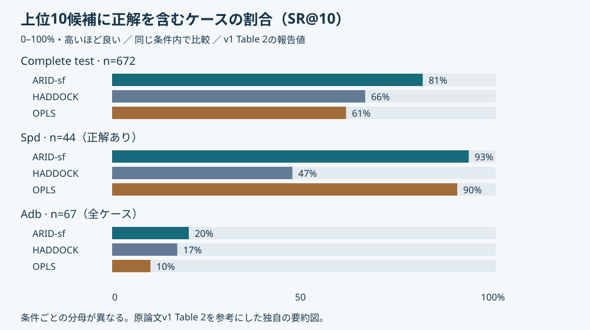

# ARID-sf: A Physics-Informed Deep Learning Scoring Function to Improve Antibody–Antigen Docking Model Ranking

[HTMLビジュアルノート](20261110_ARID-sf%20A%20Physics-Informed%20Deep%20Learning%20Scoring%20Function%20to%20Improve%20Antibody-Antigen%20Docking%20Model%20Ranking.html)

> **版の区別**：査読版はJCIM（2026年7月27日公開）。本ノートの詳細な手法・数値・Figure/Table番号は、全文と補足資料を確認できた **bioRxiv v1（2026年1月22日）** に基づく。査読版本文との差分は未確認。公開コードは査読中に更新されており、旧版と現行版の重みが併存する。

## まず何の論文か

ARID-sfは、抗体–抗原複合体の候補構造を入力し、実験構造にどれだけ近そうかを推定して並べ替えるスコア関数である。正式名はAntibody-antigen Residue Interface Docking scoring function。構造を生成する工程の後に使い、候補群から良い結合姿勢を選ぶことが目的である。各界面残基について物理的相互作用、接触、局所形状、タンパク質言語モデルの特徴を計算する。これらを自己注意機構で統合し、構造品質指標DockQの予測値を出す。通常抗体のFab/Fvと単一ドメイン抗体を対象に含む。主テスト672ケースでは、上位10候補に正解を含む割合が81%で、HADDOCKの66%を上回った。一方、大きな構造変化が必要なunbound dockingでは同指標は20%であり、難しい入力構造の問題を解決したわけではない。AlphaFold3とBoltz2の候補にも適用したが、比較は少数例で優越は統計的に有意でなかった。実験的に結合する確率やKdを予測するモデルと解釈せず、候補構造の品質評価器として読むのが適切である。[原著v1、pp.4–18](https://www.biorxiv.org/content/10.64898/2026.01.20.700530v1.full.pdf)

## 書誌情報

- URL/DOI：査読版 [10.1021/acs.jcim.6c00836](https://doi.org/10.1021/acs.jcim.6c00836)、プレプリント [10.64898/2026.01.20.700530](https://doi.org/10.64898/2026.01.20.700530)。[PubMed PMID 42573393](https://pubmed.ncbi.nlm.nih.gov/42573393/)。
- 公開日/更新日：bioRxiv v1 2026-01-22。査読版オンライン公開2026-07-27、号の発行2026-08-10。
- 著者・所属：査読版はIlyas Grandguillaume、Fernando Luis Barroso da Silva、Catherine Etchebest。Université Paris Cité／Université de la Réunion、INSERM・EFS・BIGR U1134／DSIMB、およびUniversidade de São Paulo等。v1はEtchebestとBarroso da Silvaの著者順が逆。
- 掲載誌：Journal of Chemical Information and Modeling 66(15), 9540–9553（査読済み）。
- リサーチ日：2026-11-10（日本時間）。分類：新着／抗体複合体の構造品質評価・ドッキング再ランキング。

## 背景と問題設定

ドッキングには候補を作る「探索」と、そこから正解に近いものを選ぶ「採点」がある。候補に正解が存在しても、誤った構造が上位に並べば実験や構造解釈には使いにくい。抗体ではCDRH3の多様性、抗原結合に伴う構造変化、界面のアミノ酸組成などにより、一般的なタンパク質間相互作用用スコアが十分に機能しない。

エネルギーだけでは小さな原子衝突を過剰に罰することがあり、配列・構造AIの信頼度も似た候補を十分区別しない場合がある。本研究は、物理的な項を捨てず、周辺の化学的・幾何学的文脈に応じて読み替える。評価対象は既知の抗体–抗原対から生成した正しい／誤ったポーズであり、実験的な非結合抗体を含むバインダー選別試験ではない。[v1、Introduction / Approach](https://www.biorxiv.org/content/10.64898/2026.01.20.700530v1.full.pdf)

## この論文のコアアイデア

「この原子衝突は悪い」という一律の加点・減点ではなく、「周囲の接触や配列、形状を踏まえると、この局所的な不利さを持つ界面は正解に近いか」を学習する。反発と引力を別々の特徴として渡し、界面内の残基同士をself-attentionで関連づける。題名のphysics-informedは物理ポテンシャルを入力に組み込む意味であり、物理方程式を厳密に満たす制約付きニューラルネットという意味ではない（本ノートの整理）。



原論文v1 Figure 1・2およびSM15を参考にした独自の要約図（原図の転載ではない）。出典：[原著v1](https://www.biorxiv.org/content/10.64898/2026.01.20.700530v1.full.pdf)。

## 手法の詳細

| 項目 | 確認した内容 |
|---|---|
| 入力 | 抗体と抗原の候補複合体PDB。配列も構造から対応づける。推論時に実験複合体は不要 |
| 界面 | 鎖間重原子距離5 Å以内。接触の多い順に最大75残基を採用。学習界面の95%をカバー、平均約45残基 |
| 表現 | 各残基4,253特徴。抗原・抗体・界面の集約ESM ID、中心残基と近傍残基の属性、体積特徴を含む |
| 言語特徴 | ESM-C。SM9では残基40次元、抗原・抗体・界面各96次元へ平均集約。現行コードはesmc_300mを使用 |
| エネルギー | OPLS united atom。Lennard-Jonesの反発と引力を分離し、Coulomb項とともに残基単位へ集約 |
| 接触 | 5 Å以内の原子接触と残基接触を物性カテゴリー別に数える。残基は疎水性・極性・芳香族・負電荷・正電荷 |
| 局所形状 | Cαを中心に30 Å角、3×3×3 voxel（各10 Å）。骨格と対向界面への方向で軸を決め、抗原／抗体の原子占有体積等を表現 |
| ネットワーク | 4,253→256次元、LayerNorm、位置符号化、Transformer、attention pooling、予測head。位置は配列順ではなく接触順位を表す |
| 学習 | v1 SM15では3 encoder層、8 heads、dropout 0.4/0.1、Adam、学習率10^-5、weight decay 10^-4、batch 1,000、RMSE最小化。validation RMSE改善時に保存 |
| 数値安定化 | 入力特徴を[-1,000, 1,000]に制限。75残基未満のpaddingをattentionとpoolingでmask |
| 出力 | pDockQ。sigmoidで0–1に制限、高いほど予測構造品質が良い。現行CSVにはpFNAT_env、pJACA、pJACBも含まれるが、その詳細な学習ラベル定義は未確認 |

**論文と実装の差に注意**：確認した現行scorer.pyは2 encoder層・4出力を明示的に指定する。models.pyのクラス既定値は3層だが、推論時には上書きされる。v1の「3層」と現行実装の「2層」を混同しない。学習epoch数と現行重みの完全な学習設定は未確認。[SM9・15](https://www.biorxiv.org/content/biorxiv/early/2026/01/22/2026.01.20.700530/DC1/embed/media-1.pdf?download=true)、[scorer.py](https://github.com/DSIMB/ARID-sf/blob/main/ARIDv2.0/scorer.py)

## データセットと評価設計

ANABAGの2,151実験複合体を1,046ケースへ整理し、抗原配列20% identityを基準に263クラスターへ分けた。trainは997ケース／230クラスター、validationは34／18、内部testは15／15。正解界面を用いたHADDOCK3のguided dockingで学習用候補を作り、rigidbody・flexref・waterの構造を使う。正解／不正解を概ね半々に整えるため、実運用の候補分布とは異なる。

| 評価集合 | 規模・出発構造 | 評価上の意味 |
|---|---|---|
| Complete test | 内部15＋Ab-blind 376＋Ab-site 281＝672ケース | AbSet由来のblind再ドッキングと予測抗体を含む。外部ケースはtrainとの抗原>20%または抗体>95% identityを除外 |
| Spd | 100ケースから正解候補を生成できた44ケース。各3,000＝132,000モデル | 界面RMSD約0.5 Åの軽微な摂動。12ケースはABodyBuilder2由来抗体。抗原<20%、抗体<80% identity |
| Adb | ABAG-docking benchmark 67ケース、各4,000＝268,000モデル | 非結合状態の実験構造を出発点にし、39ケースのみ正解候補を含む |
| AF3 / Boltz2 | 22ケース、各手法5 seeds×5＝25モデル/ケース | SR解析は正解と不正解が混在するAF3 7ケース175モデル、Boltz2 8ケース200モデルに限定 |

**規模の不整合を保留する**：v1本文は学習データ全体を1,544,000モデルとするが、Table 1のtrain行は1,015,118＋456,607＝1,471,725。前者はvalidation/testを含む生成集合の説明と読む必要がある。Complete testも本文の3集合合計735,913とTable 1の186,375が一致しない。Abstractの「806ケース」も表のケース数を単純合算した値とは一致せず、重複除去の対応表がないため独立複合体総数として再計算しない。SpdはAbSet由来なので、評価条件が別でも全評価集合が相互に独立とは限らない。[v1 pp.4–7、Table 1](https://www.biorxiv.org/content/10.64898/2026.01.20.700530v1.full.pdf)

指標は、上位N件に正解が1個以上あるケースの割合SR、上位N件の正解ポーズ割合HR、閾値を最適化した最小誤分類率MCR。正解は実測参照構造とのDockQ≥0.23。MCRは評価集合上の最適値なので、その閾値を新規データへそのまま持ち込んだ精度とは異なる。比較はHADDOCK（界面拘束の罰則項を除外）、未重み付けOPLS、SpdでRosetta REF2015 total_scoreとAbEpiScore-1.0、co-folding候補でipTMとranking/confidence score。

## 主要結果

次表は**v1 Table 2の値**。同一ケース群・同一top-N内で比較する。Spdは正解候補が存在する44ケースに条件づけられ、Adbは67ケース全体を分母にするため、93%と20%を手法の単純な能力差として比較しない。

| 評価条件 | ARID-sf SR@1 / SR@10 | HADDOCK | OPLS |
|---|---|---|---|
| Complete test（672） | 46% / 81% | 39% / 66% | 37% / 61% |
| Spd（44） | 93% / 93% | 40% / 47% | 70% / 90% |
| Adb（67） | 15% / 20% | 12% / 17% | 0% / 10% |



原論文v1 Table 2を参考にした独自の要約図（原図の転載ではない）。指標はSR@10、単位%、高いほど良い。出典：[v1 p.12](https://www.biorxiv.org/content/10.64898/2026.01.20.700530v1.full.pdf)。

主テストでHADDOCK比の改善はSR@1で7ポイント、SR@10で15ポイント。Table 2は両者との差を有意とする。一方、AdbでのHADDOCK比3ポイントを有意な改善とは報告していない。Table 2の±は標準偏差で、平均の95%信頼区間ではない。SpdのHADDOCK SR@10は本文に約56%とも書かれ、表の47%と食い違うため、本ノートは表の値に統一した。

分類について、ARID-sfのMCR／最適閾値はflexible再ドッキング6.6%／0.57、予測抗体22.9%／0.23、rigid再ドッキング24.1%／0.34。Spdは1.0%／0.540。**pDockQ>0.23なら常に正解、という万能な閾値は得られていない**。

Adbではtop50で正解を拾ったケースがARID-sf 17、HADDOCK 9、OPLS 10。入力界面のbound状態からのRMSDが1.5 Å以上になると各手法のHRはランダムに近づいた。Figure 6Aは正解候補を含む39ケースのみを描く点にも注意する。

AF3／Boltz2では自前信頼度に対し同等〜やや良いが、有意差なし。Figure 4Bの例は、ARID-sfが異なる姿勢クラスターを区別しても**全候補がDockQ基準では不正解**である。探索で正解を作れなかった問題を再ランキングだけで救えるとはいえない。

速度はSM16で40 CPU coresの並列処理時3,000–5,000モデル/分。本文はSpd 132,000モデルを約1時間、AbEpiScoreを約3日と報告する。ESM埋め込みは同じ抗体–抗原系で再利用する条件であり、異なる配列対を大量に一度ずつ採点する速度へは直結しない。[v1 Results、SM16](https://www.biorxiv.org/content/10.64898/2026.01.20.700530v1.full.pdf)

## 重要なFigure/Table

### Figure 2：局所環境をどう数値にするか

- 何を示すか：Aは4,253次元表現、Bは接触、CはESM集約、Dはエネルギー分解、Eはvoxel体積。
- 読み取り方：中心残基だけでなく近傍と界面全体の文脈を併せ持つ点を追う。75×4,253は画像の解像度ではなく、残基数×特徴数。
- 主要傾向／重要性：反発・引力の分離が、単一エネルギー和を使う手法との設計上の差。Transformerが読むものを理解する中心図。
- Markdown／HTML内での扱い：両方で独自フロー図。原図の転載なし。
- 出典URL：[v1 Figure 2、p.8](https://www.biorxiv.org/content/10.64898/2026.01.20.700530v1.full.pdf)。ライセンス：v1 PDFのCC BY 4.0を確認済み。査読版図のライセンスは未確認。

### Table 2：上位候補を選ぶ能力

- 何を示すか：3条件におけるSR@1とSR@10、標準偏差、有意差表示。
- 読み取り方：同じ行・同じtop-Nで手法を比較し、条件間では分母の選別を確認する。
- 主要数値／重要性：Complete test SR@10 81%対66%。Spdで強いがAdbは20%にとどまる。平均的な改善と難例での限界を同時に確認できる。
- Markdown／HTML内での扱い：必要列を再構成した表と独自棒グラフ。
- 出典URL：[v1 Table 2、p.12](https://www.biorxiv.org/content/10.64898/2026.01.20.700530v1.full.pdf)。ライセンス：v1 CC BY 4.0確認済み。数値表を独自に要約。

### Figure 6：入力構造のずれが増えたとき

- 何を示すか：AはAdbのSR曲線、Bは界面RMSD区間ごとのHR@50。
- 読み取り方：Aの分母は正解を含む39ケース。Bは縦軸がSRではなくHRで、各区間のケース数も異なる。
- 主要傾向／重要性：1.5 Å以上ではランダムに近づく。良い採点器と構造探索の限界を切り分ける図。
- Markdown／HTML内での扱い：リンクと詳細解説。原図転載なし。
- 出典URL：[v1 Figure 6、pp.17–18](https://www.biorxiv.org/content/10.64898/2026.01.20.700530v1.full.pdf)。ライセンス：v1 CC BY 4.0確認済み。

## Code / License / Weights

- コード公開：あり。[GitHub URL：DSIMB/ARID-sf](https://github.com/DSIMB/ARID-sf)。GitHub以外のコードURL：見つからず。実装種別：著者実装／公式。GitHub確認：確認済み。
- リポジトリのライセンス：MIT。確認元：[LICENSE](https://github.com/DSIMB/ARID-sf/blob/main/LICENSE)（Copyright 2026 DSIMB）。依存するESM-C／HADDOCK等の利用条件とは別。
- 確認コミット：dfb60e1c6969a7086455460e696de399153476db（2026-11-10取得時main）。
- Hugging Face URL：ARID-sf公式公開物は見つからず。種別：該当なし。名称検索で返った第三者ベンチマークは公式重みとみなしていない。
- モデル重み・チェックポイント公開：あり。[現行ARID_20_Std.pt](https://github.com/DSIMB/ARID-sf/blob/main/ARIDv2.0/ARID_20_Std.pt)、[旧ARID_20_Std_preprint.pt](https://github.com/DSIMB/ARID-sf/blob/main/ARIDv2.0/ARID_20_Std_preprint.pt)。GitHub Releasesは空。READMEに査読中の重み更新の記載あり。
- データセット公開：入力例と出力例あり。[example](https://github.com/DSIMB/ARID-sf/tree/main/example)。全学習・評価decoyと分割リストの一括公開は、確認したREADME／repository tree／補足資料では見つからず。
- 元データの入口：[ANABAG論文](https://doi.org/10.1021/acs.jcim.5c01599)、[AbSet論文](https://doi.org/10.1021/acs.jcim.5c00410)、[ABAG-docking benchmark論文](https://doi.org/10.1093/bib/bbae048)。これらの公開とARID-sf生成decoy全体の公開を区別する。

再現性メモ：READMEに従いPython 3.11、PyTorch、ESM、Cython extensionを用意する。PDBは抗原をA、抗体をBとし、抗原を先に記載、残基を連続番号化し、OPLS-UAの原子命名に合わせる。AF3/Boltz2構造もHADDOCK3 topoaaで処理してから採点している。READMEのformattingという説明に対し実際のディレクトリ名はformatingである。同一フォルダには同じ抗体–抗原系の候補だけを置く。異なる系の単一構造にはscore_refs.pyを使う。

```bash
python ARIDv2.0/score_round.py example/models example/outputs/example_output.csv
```

今回はソース・重みの公開状況を確認した段階で、環境構築、重みの実行、論文性能の再現は行っていない。

## 抗体研究・創薬への意味

HADDOCKで多数の候補を作り、実験で確かめる姿勢や変異設計の出発点を絞る用途に合う。通常のエネルギー順位とARID-sf順位が食い違う候補を調べれば、軽微な衝突に強く罰せられた近正解構造を救える可能性がある。AF3／Boltz2由来構造の補助評価としても使えるが、独立した自前データで確認する必要がある。

本ノートの提案として、VHH設計候補にはipTM等と併記し、既知複合体・誤ポーズ・可能なら実験陰性を分けて検証する。ARID-sfが高くてもKd、発現性、凝集、糖鎖干渉、生体内機能は保証されない。ESpmaの生物学的界面／結晶接触分類とも、SpatialPPIのPPI判別とも教師ラベルが異なる。

## 限界と注意点

**著者が述べる限界**：正解判定の最適閾値が条件依存。HADDOCKのみで学習した生成法バイアス。局所残基の良し悪しと複合体全体の教師ラベルの不一致。翻訳後修飾、pH、イオン強度は未対応。SM21は高い抗体配列類似性の群ほど性能が上がり、配列パターンの記憶が一部残る可能性も述べる。Abstractの頑健性の主張だけでリーク対策が完全と判断しない。

**本ノートの評価**：Spdの44/100ケース選別とAF3／Boltz2の混在ケース選別は、順位づけ能力を見るには有用だがend-to-end成功率を上振れさせる。抗原identityによる分割は有用でも、同系抗体や類似エピトープを完全に排除した証拠ではない。Table 2の検定はtwo-sample t-testで、同一ケースへの手法比較なら対応を考慮した検定やpaired bootstrapも確認したい。v1の集計数・表と本文の不整合、現行コードとの層数差は再現時の課題。実験バインダー選別やde novo設計の成功率改善は直接実証されていない。

## この論文を読む上での前提知識

- **DockQ**：参照複合体との接触・位置ずれから構造品質を数値化する指標。真のDockQは実験参照が必要で、pDockQはその推定。
- **re-docking / unbound docking**：前者は結合済み複合体から分けた構造を再会合させる。後者は非結合時の構造等から始めるため、結合時への変形も問題になる。
- **paratope / epitope**：抗体側／抗原側の結合面。界面はCDR以外も含みうる。
- **OPLS-UA**：一部水素を重原子へまとめた力場表現。原子名・水素・残基形式を整える前処理がエネルギー計算に影響する。
- **self-attention / pooling**：界面残基間の関係を学び、可変数の残基から複合体全体の表現へまとめる操作。
- **SRとHR**：正解を一つでも拾えた「ケースの割合」と、選んだ「ポーズの正解割合」。両者は同じではない。

## 今回この1報を選んだ理由

ユーザー指定論文。予測抗体–抗原複合体の妥当性を検討する目的に直接対応し、物理情報とpLMを統合する設計が学べる。既存Weeklyの界面信頼度、ESpma、SpatialPPIのノートに「既知の組合せ内のポーズ品質」という別の評価軸を追加できる。査読済み研究で、公式コードと現行／旧重みの両方を確認できる点も重要。

## 読む優先度

**High**。多数の抗体複合体候補を順位づけしたい場合に直接役立つ。Figure 2→Table 2→Figure 6→SM15と現行実装の順に読むと、強み・適用限界・再現性を押さえやすい。

## 自分用メモ

- 現行重みとpreprint重みで同じ候補群を採点し、順位と校正の変化を調べる。その前に各重みとnetwork設定の対応を確認する。
- VHHとFab/Fvを分けて、入力構造のずれ、抗原類似性、候補生成法別にSR@1/10とHRを検証する。
- 関連して読む論文：[DockQ](https://doi.org/10.1371/journal.pone.0161879)、[AbEpiTope-1.0](https://doi.org/10.1126/sciadv.adu1823)、[ABAG-docking benchmark](https://doi.org/10.1093/bib/bbae048)。
- 実装の入口：README→scorer.py→models.py→create_interface_features_v1.py。macOSでは配布済みLinux用.soを使わず、環境に合わせてビルドが必要。
- Obsidianリンク候補：[[DockQ]]、[[抗体抗原複合体構造予測]]、[[HADDOCK]]、[[ESM-C]]、[[VHH]]。

## 関連キーワード

ARID-sf、pose ranking、model quality assessment、physics-informed features、OPLS-UA、ESM Cambrian、Transformer、CAPRI、DockQ、unbound docking。

## 検索ログ

- 2026-11-10：Web検索「ARID-sf antibody antigen」「ARID-sf Figure」「ARID-sf figshare」「ARID-sf site:huggingface.co DSIMB」。ユーザー指定の1報を採用し、別候補の追加選定は行っていない。
- 査読版DOI／ACS公開ページ・Crossref書誌を確認。査読版は購入アクセス表示で本文を確認できず、公開Abstractと書誌のみ使用。オンライン公開日と号の日付を区別した。
- bioRxiv v1全文PDF（26ページ）と補足PDFを取得・読解。本文全Figure 1–6とTable 1–2の説明を確認し、Figure 2・Table 2・Figure 6のページをレンダリングして目視確認。詳細数値はv1と明示。PDF内のCC BY 4.0を確認し、今回は独自模式図・数値再構成を使用。
- [公式GitHub](https://github.com/DSIMB/ARID-sf)、README、LICENSE、recursive tree、models.py、scorer.py、get_esm_embeddings.pyを確認。重み2種・exampleを確認、[Releases](https://github.com/DSIMB/ARID-sf/releases)は空。
- [Hugging Face models APIのARID-sf検索](https://huggingface.co/api/models?search=ARID-sf)は空。Web上の第三者AF3ベンチマークは本論文の成績として採用しない。
- 全学習decoyの一括URLは確認範囲で見つからず。元データ論文の公開と派生decoyの公開を区別した。査読版Supporting Informationの存在は確認したが、内容の照合にはv1補足を使用。
- 元資料：[v1全文PDF](https://www.biorxiv.org/content/10.64898/2026.01.20.700530v1.full.pdf)、[v1補足資料](https://www.biorxiv.org/content/biorxiv/early/2026/01/22/2026.01.20.700530/DC1/embed/media-1.pdf?download=true)、[査読版](https://doi.org/10.1021/acs.jcim.6c00836)。
